# Nitro Underground

**Gioco di corse clandestine in 3D per Android, con grafica realistica.**
Fatto con Godot 4 · fisica dei veicoli scritta da zero · circuiti scritti come mappe di testo.

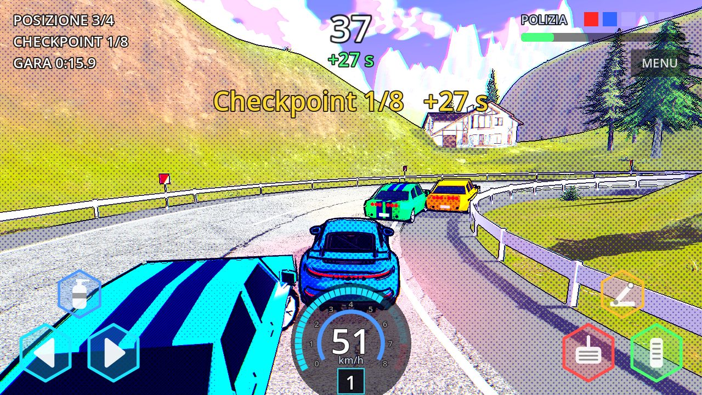

📖 [Storia dello sviluppo](docs/STORIA.md) · 🛠️ [Come è costruito](docs/TECNICO.md) · 🎨 [Crediti e licenze](CREDITI.md) · 🇬🇧 [English](#english)

---

## In 30 secondi

- **Cos'è:** un racing arcade per telefono nello spirito delle gare su strada: sorpassi nel
  traffico, nitro, derapate, salti e la polizia che arriva se fai troppi danni. Nome, mondo e
  circuiti sono originali.
- **Chi l'ha fatto:** **Stefano Paglierani** ha ideato e diretto il gioco: concept, stile,
  circuiti, auto, comandi e ogni scelta di prodotto, provando ogni build sul suo telefono Android.
  Il codice è stato scritto da **Claude** (l'assistente AI di Anthropic) sulle sue indicazioni.
- **In quanto tempo:** 13 giorni, dal 27 ottobre all'8 novembre 2026: **29 versioni** dal primo prototipo
  alla v0.22.2, ognuna provata su telefono o PC e migliorata in base alle prove.
- **Cosa dimostra:** direzione di prodotto e game design su un progetto reale, ciclo rapido
  prova → feedback → nuova versione, uso dell'intelligenza artificiale come squadra di sviluppo,
  attenzione alle licenze degli asset e alle prestazioni su telefono.

## Screenshot (v0.17-v0.22, grafica realistica)

| | |
|---|---|
| 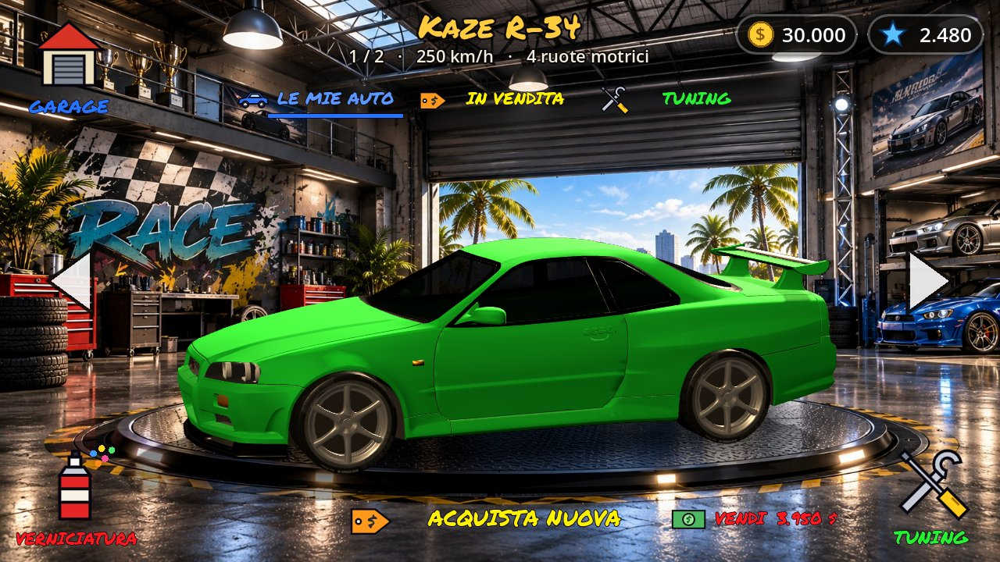 | 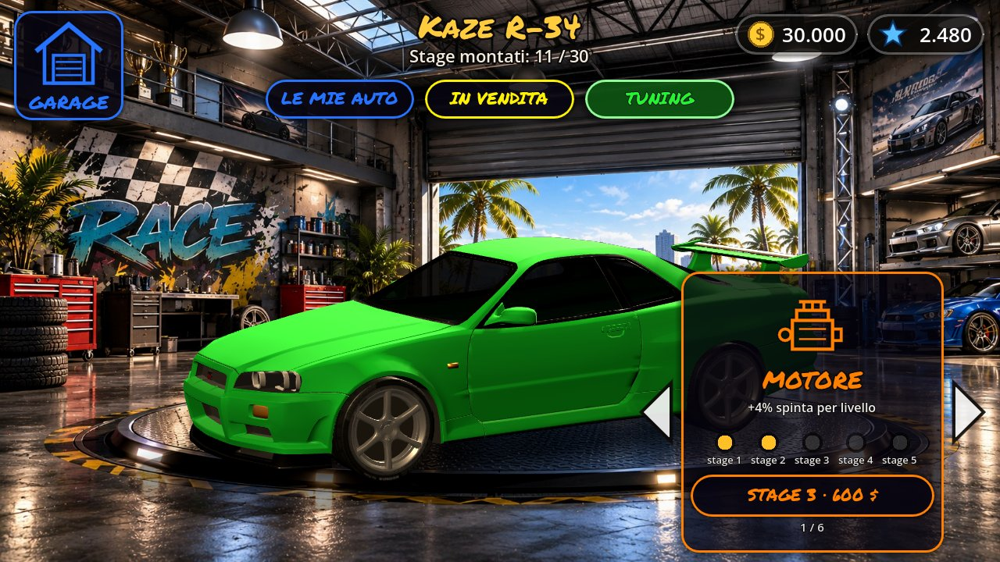 |
| *Dealer: l'auto sul piatto dello showroom, colori e acquisti* | *Tuning: sei elaborazioni a cinque livelli* |
| 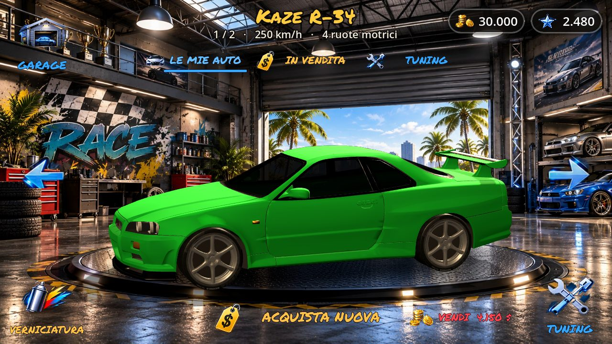 | 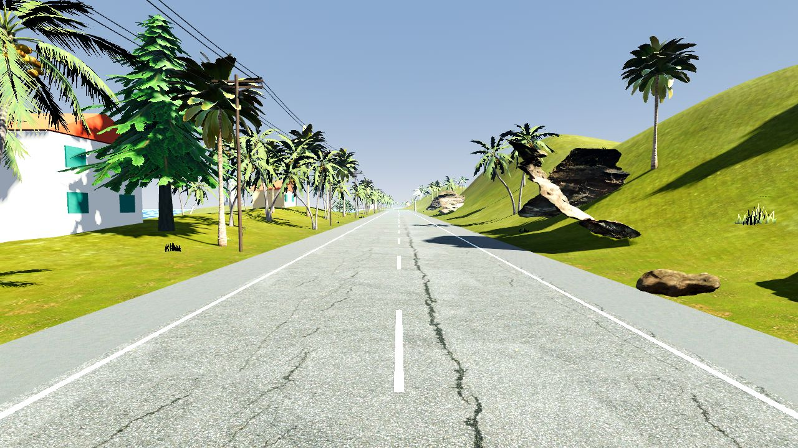 |
| *Garage con le icone scelte da Stefano (v0.22.2)* | *Costa: ambienti più pieni (v0.21)* |
| 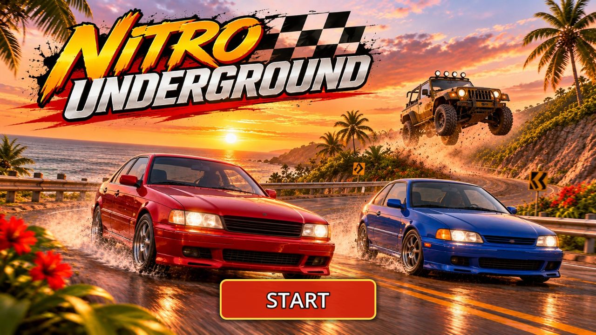 | 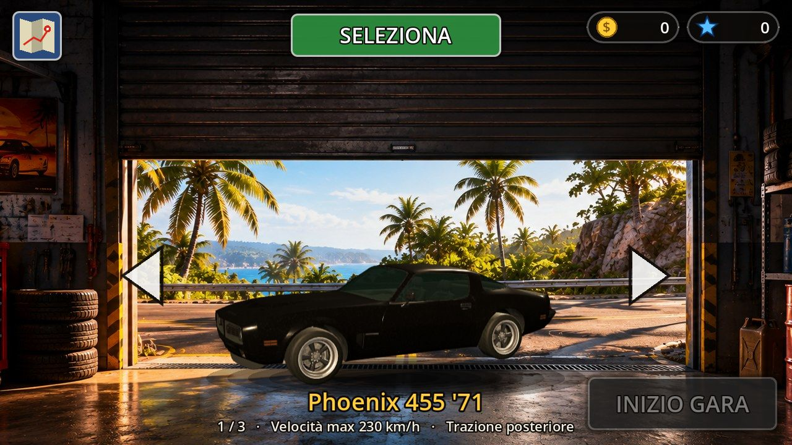 |
| *Pagina d'attesa: l'immagine scelta da Stefano e il pulsante START* | *Garage: 3 auto, scelta definitiva, denaro e reputazione* |
| 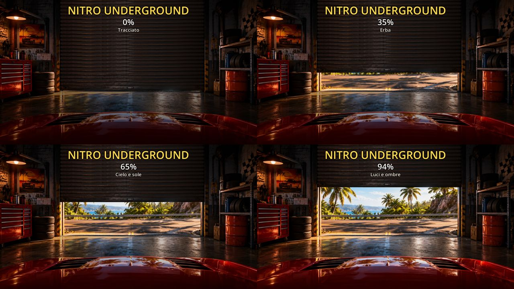 | 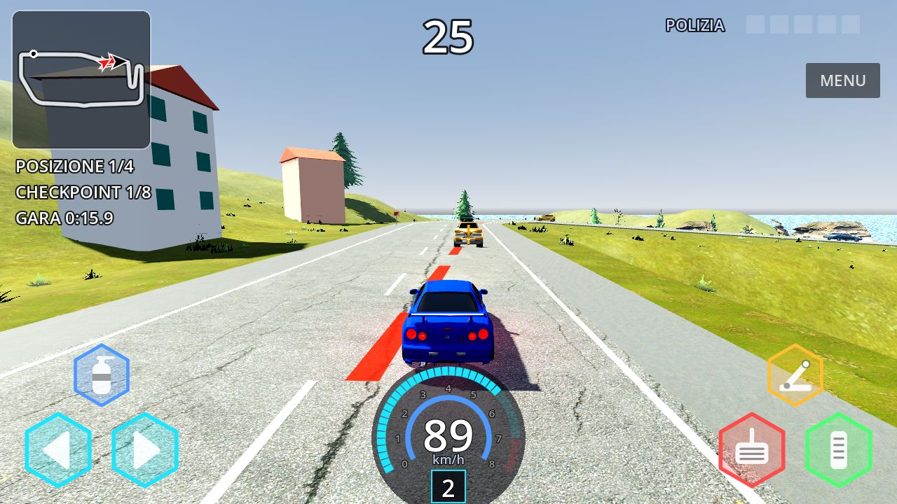 |
| *Caricamento: la serranda del garage si alza con la percentuale* | *Gara sulla costa: minimappa con le frecce delle auto* |

### Com'era nella v0.11.1 (stile a fumetto 2.5D, abbandonato nella v0.13)

| | |
|---|---|
| 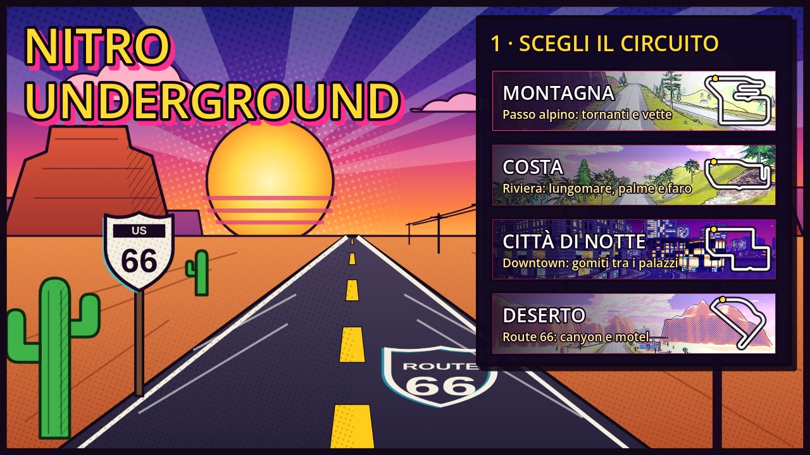 | 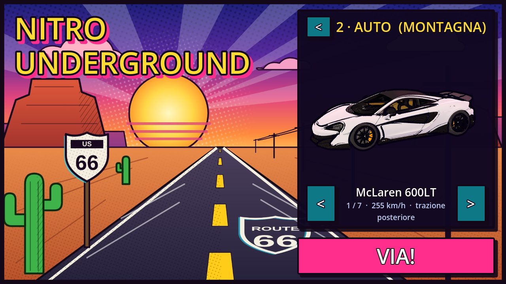 |
| *Menu: illustrazione originale della Route 66, scelta del circuito* | *Garage: 7 auto, ognuna con velocità e trazione proprie* |
| 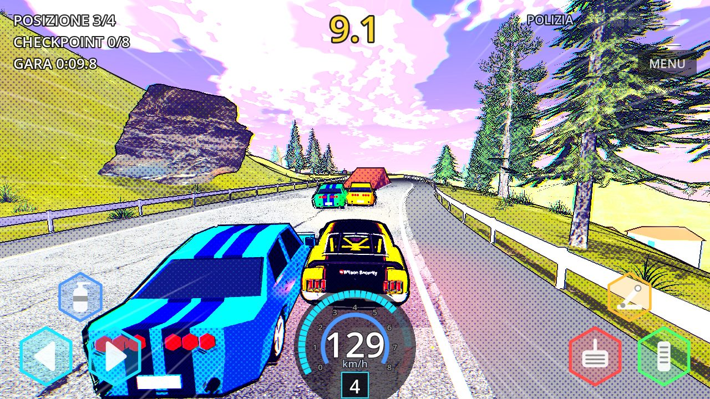 | 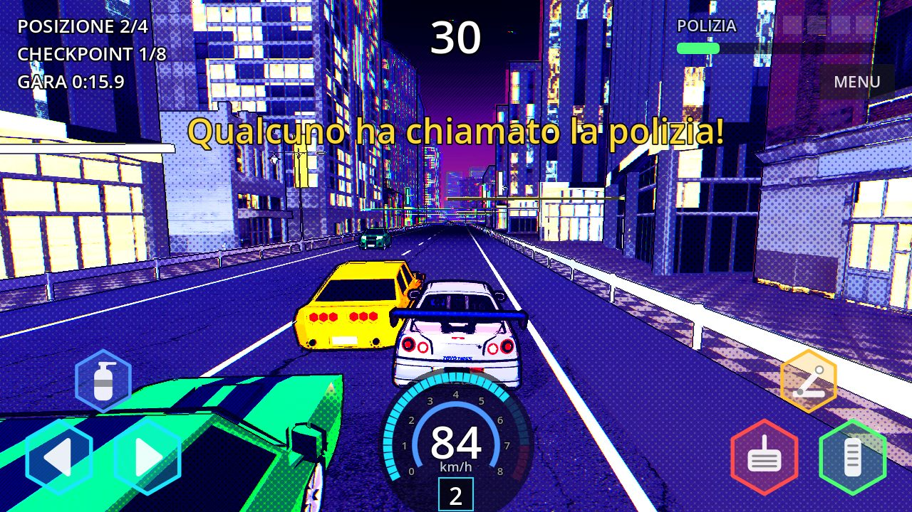 |
| *Costa: lungomare, palme e traffico* | *Città di notte: palazzi con finestre accese, neon* |
| 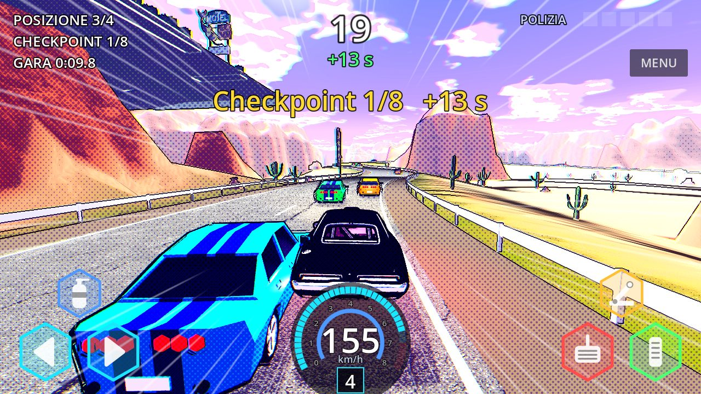 | 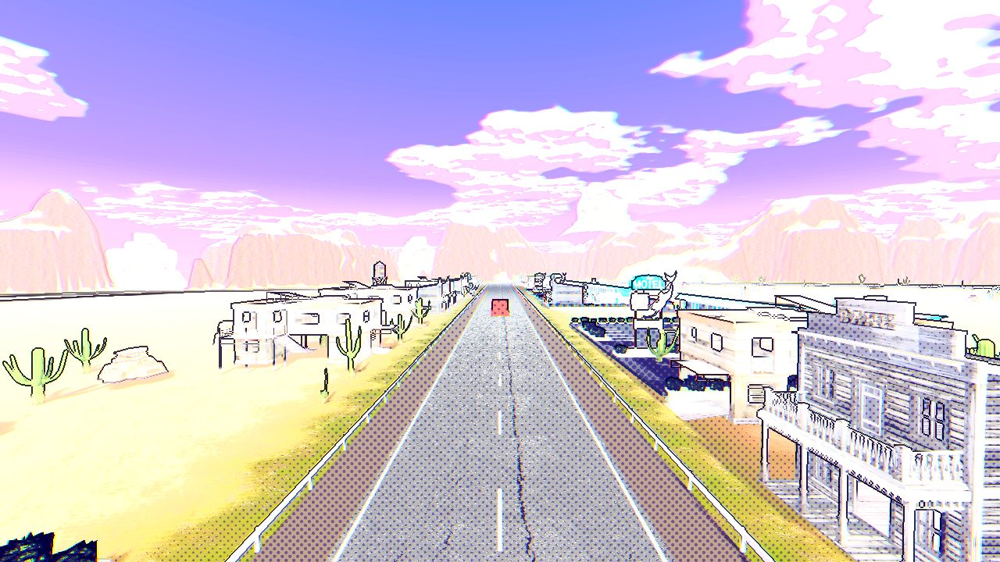 |
| *Deserto: la Route 66 attraverso il canyon* | *Deserto: paese con motel e distributore* |
| 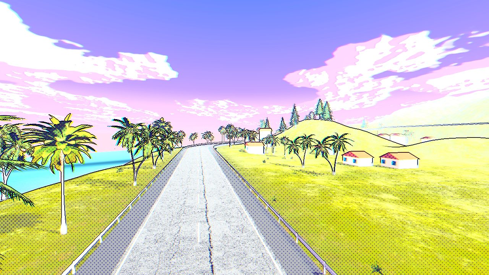 | 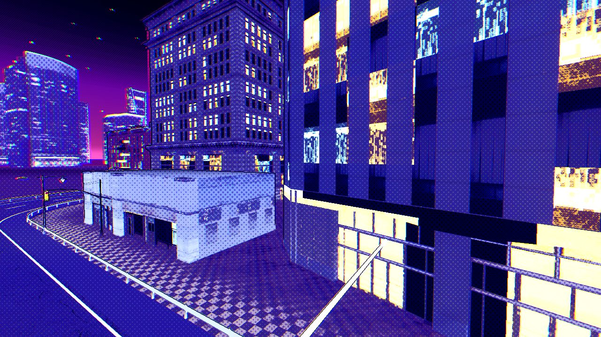 |
| *Costa: palme, mare e case bianche* | *Città di notte: skyline di torri illuminate* |

## Cosa c'è nel gioco

| | |
|---|---|
| 🏠 **Garage** | Dopo la pagina START: scelta definitiva fra 3 auto, denaro (5.000 a gara) e reputazione (vittorie, derapate in combo, polizia seminata); le gare si susseguono: Costa, Città, Deserto, Montagna |
| 🏪 **Dealer** | 14 auto in vendita su un piatto girevole, colore RGB, elaborazioni di motore, centralina, scarico, nitro, freni e sospensioni |
| 🏁 **4 circuiti** | Montagna (passo alpino con tornanti), Costa (riviera), Città di notte (downtown), Deserto (Route 66) |
| 🚗 **14 auto** | Tutte con licenza commerciale (CC BY), con nomi inventati: le guidano anche i rivali; 4 volanti e 13 mezzi nel traffico, autobus compreso |
| ⏱️ **Gara sprint** | 3 avversari guidati dal computer, checkpoint con tempo a scalare |
| 🚓 **Polizia** | Gli incidenti alzano il livello di allerta e arrivano le volanti |
| 💥 **Fisica vera** | Corpo rigido su 4 ruote con sospensioni, salti, derapate, traffico che si urta |
| 🔊 **Audio** | Motore V8 sintetizzato che segue i giri, cambiate, turbo, gomme, urti, sirena |
| 🎨 **Grafica realistica** | Modelli 3D realistici con le impostazioni grafiche di base (lo stile a fumetto 2.5D è stato abbandonato nella v0.13) |
| 🗺️ **Circuiti in testo** | Ogni pista è un file che si legge come un navigatore: chiunque può disegnarne una |
| 📱 **Comandi touch** | Pulsanti a esagono con icone, cruscotto digitale, minimappa con le frecce delle auto, traiettoria ideale colorata a terra |

## Come è costruito, in breve

Il dettaglio completo, con diagrammi e numeri, è in **[docs/TECNICO.md](docs/TECNICO.md)**.

- **Fisica dell'auto scritta da zero** su `RigidBody3D` + Jolt: ruote come cilindri proiettati
  che salgono sui cordoli, sospensioni molla-smorzatore, aderenza per ruota limitata dal carico,
  cambio a 6 marce. Verificata con un banco prova automatico: **0-100 km/h in 3,5 s**, frenata da
  144 km/h in 63 m, salti **entro il 2,5% della traiettoria balistica teorica**, stessi risultati a
  30, 60 e 120 tick al secondo.
- **Un linguaggio per disegnare i circuiti** (`tracks/*.txt`): `DRITTO 520`, `TORNANTE DESTRA`,
  `CHICANE SINISTRA`... Il gioco chiude l'anello da solo e ne ricava strada, terreno,
  traiettoria ideale, velocità in curva per l'IA e tempo dei checkpoint.
- **Grafica realistica** con le impostazioni di base di Godot. Lo stile a fumetto fatto con shader
  (v0.9-v0.12) è spento dalla v0.13: sul telefono era troppo pesante e Stefano è tornato al realistico.
- **Progressi salvati sul telefono** (`scripts/save_game.gd`): auto possedute, colore ed
  elaborazioni di ognuna, denaro, reputazione e prossima gara della campagna in un piccolo file di configurazione; la reputazione cresce con vittorie, polizia
  seminata e derapate in combinazione che raddoppiano il valore.
- **Costruito dal codice**: le scene sono quasi vuote, strade, terreno, auto, interfaccia e
  materiali nascono dagli script. Tutto è testo leggibile e versionato.
- **Pensato per il telefono**: caricamento a passi con modelli letti in thread paralleli, modelli
  3D fusi per ridurre le chiamate di disegno (la Porsche da 8.270 a 148), texture compresse con
  mipmap (in gara da 418 a 104 MB).
- **Licenze tracciate**: oltre 120 asset gratuiti registrati con autore, link e licenza.

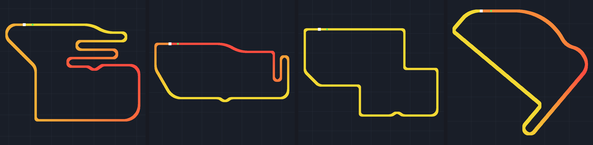

## Come è cambiato

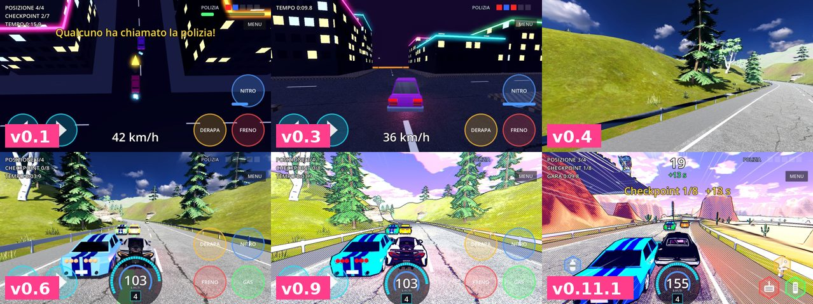

Dalla città low poly vista dall'alto del primo giorno, passando per il fumetto 2.5D, al ritorno alla grafica realistica: ogni svolta è nata
dalle prove sul telefono. La [storia completa](docs/STORIA.md) racconta, versione per versione,
cosa è stato chiesto e come è stato costruito.

| Versione | In una riga |
|---|---|
| v0.1 | Primo prototipo giocabile sul telefono: città notturna, visuale dall'alto |
| v0.2-v0.3 | Fisica a corpo rigido, telecamera dietro l'auto, salti |
| v0.4-v0.6 | Montagna di giorno, garage, guida dalle ruote, cruscotto, guardrail distruttibili |
| v0.7-v0.9 | Audio, traffico urtabile, comandi a esagoni, stile a fumetto 2.5D |
| v0.10 | Menu Route 66, caricamento leggero, tempo a scalare |
| v0.11-v0.11.1 | Circuiti come mappe di testo, ambientazioni rifatte, Deserto, garage da 7 |
| v0.12 | Stabilizzazione: pausa, polizia più giusta, rivali più veloci, traffico che si libera da solo |
| v0.13-v0.13.1 | Il telefono si bloccava: auto e texture alleggerite, ritorno alla grafica realistica, via i guardrail |
| v0.14 | OpenGL sul telefono, nuovo garage e traffico dettagliato, auto pre-cotte per un menù veloce |
| v0.15 | Solo auto vendibili (CC BY), nomi inventati e loghi tolti |
| v0.16 | Auto lontane leggere contro gli scatti, asfalto a filo, avviso di contromano |
| v0.17 | Si parte dal garage (3 auto, scelta definitiva), minimappa in gara, caricamento con la serranda |
| v0.18 | Pagina d'attesa con START, denaro e reputazione guadagnati in gara, asfalto rialzato |
| v0.19 | Dealer: compra auto, colore RGB, 6 elaborazioni a 5 livelli; campagna Costa → Città |
| v0.20 | Dealer rifatto: auto grande sul piatto, sezioni, vendita, 15 colori, tuning a schede, pulsanti neon |
| v0.20.1 | Dealer: colori pastello, tuning sfogliabile come un catalogo, ombra dell'auto sul piatto |
| v0.20.2 | Showroom con pavimento 3D che riprende la foto: ombre vere e riflesso dell'auto |
| v0.20.3 | Dealer: colori accesi (rosso, giallo limone, verde, blu elettrico), scheda tuning sopra l'auto |
| v0.20.4 | Pulsanti a figure colorate senza riquadro, auto ferma da girare col dito, tuning tre volte più forte |
| v0.21 | Ambienti più pieni: 51 modelli nuovi (boschi, rocce, case americane, arredo urbano, pali della luce), meno neon in città |
| v0.22 | Telefono molto più leggero (profilo grafico apposta), freno vero, freno a mano controllabile, nitro forte, auto più pesanti, rientro in pista nel senso giusto |
| v0.22.1 | Garage e dealer con il set di icone disegnato per il gioco (Nitro UI Icon Pack) |
| v0.22.2 | Le icone giuste: ritagliate dal foglio di icone racing di Stefano |

## Provarlo

**PC Windows (il modo più semplice):** scarica [`Gioca-Nitro.bat`](tools/windows/Gioca-Nitro.bat)
e [`gioca-nitro.ps1`](tools/windows/gioca-nitro.ps1) nella stessa cartella e fai doppio clic sul
`.bat`. La prima volta scarica Godot 4.7.2 e l'ultima build (ramo `prova-pc`), prepara i modelli
(5-10 minuti) e avvia il gioco.

| Tastiera | Azione |
|---|---|
| ← → oppure A D | Sterzo |
| ↑ oppure W / ↓ oppure S | Gas / Freno e retromarcia |
| Spazio | Freno a mano (derapata) |
| Shift oppure N | Nitro |

**Android:** gli APK (circa 300 MB) non sono nel repository. Si possono creare con
`GODOT=/percorso/godot tools/build_android.sh` (servono i template Android di Godot 4.7).

**Editor:** apri la cartella con **Godot 4.7** e premi Play.

## Struttura del repository

| Percorso | Contenuto |
|---|---|
| `scripts/` | Tutto il gioco: pagina START, garage, dealer e tuning, salvataggio, gara, auto, circuiti, traffico, audio, minimappa, interfaccia |
| `shaders/` | Stile a fumetto (spento), cielo, terreno, mare, facciate illuminate |
| `tracks/` | Le mappe dei circuiti in testo e la guida [`COME_FARE.md`](tracks/COME_FARE.md) |
| `assets/` | Modelli, texture e suoni, con il registro [`LICENSES.md`](assets/LICENSES.md) |
| `tests/` | Banco prova della fisica |
| `tools/` | Build Android, preparazione delle auto (`bake_cars.gd`), anteprima mappe, screenshot automatici, launcher Windows, sintesi audio |
| `docs/` | Storia, documentazione tecnica, immagini |

## Licenze

Tutti gli asset vengono da fonti gratuite (CC0 e CC BY) e sono registrati in
[`assets/LICENSES.md`](assets/LICENSES.md). Alcuni modelli di auto (marchi reali, licenze non
commerciali) sono usati solo perché questo è un prototipo senza scopo commerciale: il riepilogo
onesto è in [CREDITI.md](CREDITI.md). Il codice non ha ancora una licenza open source: tutti i
diritti sono riservati all'autore.

## Roadmap

1. ~~Documento di concept~~ ✔
2. **Prototipo giocabile su telefono** ← siamo qui (v0.1 → v0.22.2, fase di stabilizzazione)
3. Vertical slice: un circuito e un'auto rifiniti al livello del gioco finale
4. Produzione e pubblicazione, con sostituzione degli asset non commerciali

---

## English

**Nitro Underground** is a 3D arcade street-racing game for Android with realistic graphics (the 2.5D comic look was dropped in v0.13),
built with **Godot 4.7** (GDScript, Compatibility/OpenGL renderer on Android, Jolt physics). Current version:
**v0.22.2**, a playable prototype (stabilisation phase).

**Who made it.** **Stefano Paglierani** conceived and directed the game: concept, art direction,
circuits, cars, controls and every product decision, testing each build on his Android phone.
The code was written by **Claude** (Anthropic's AI assistant) from his direction. 29 versions were
designed, built and play-tested in 13 days (27 October - 8 November 2026).

**Highlights**
- **Custom vehicle physics** on a `RigidBody3D`: shape-cast wheels that climb kerbs,
  spring-damper suspension, load-limited tyre grip, FWD/RWD/AWD, 6-speed gearbox. Validated by an
  automated bench: 0-100 km/h in 3.5 s, ramp jumps within 2.5% of the ballistic prediction,
  frame-rate independent at 30/60/120 Hz.
- **A tiny track-description language** (`tracks/*.txt`, Italian keywords such as `DRITTO`,
  `TORNANTE`, `CHICANE`) that auto-closes the loop and generates road, terrain, a
  racing line with a speed profile for the AI, and checkpoint times.
- **Realistic rendering** with Godot's base settings since v0.13; the earlier 2.5D comic shaders
  (toon materials, full-screen ink/halftone pass) are kept in the code but switched off, as they were too heavy for the phone.
- **Career loop foundations** (v0.17-v0.18): a start page, a garage where the first car is picked
  for good, money earned per race and reputation earned from wins, police escapes and chained
  drifts, all saved on the device; an in-race minimap and a loading screen where a garage door
  rises with the progress. Since v0.19-v0.20 a **dealer** to buy and sell cars, repaint them
  and upgrade six parts over five stages, and a campaign of four races in a row.
- **A phone performance profile** (v0.22, `scripts/perf.gd`): on the test phone the game lowers
  the 3D resolution and the heaviest effects by itself.
- **Synthesized V8 engine audio**, crossfaded and pitched to RPM in real time.
- **Mobile-minded**: staged, threaded loading; models merged into one mesh per material
  (a 123-part model went from 1,000+ draw calls to a handful); GPU-compressed textures.
- **Rigorous asset licensing**: 120+ free assets logged with author, link and licence; the
  non-commercial exceptions are declared openly in [CREDITI.md](CREDITI.md).

Docs (in Italian): [development history](docs/STORIA.md) · [technical deep dive](docs/TECNICO.md).
The code has no open-source licence yet (all rights reserved).
