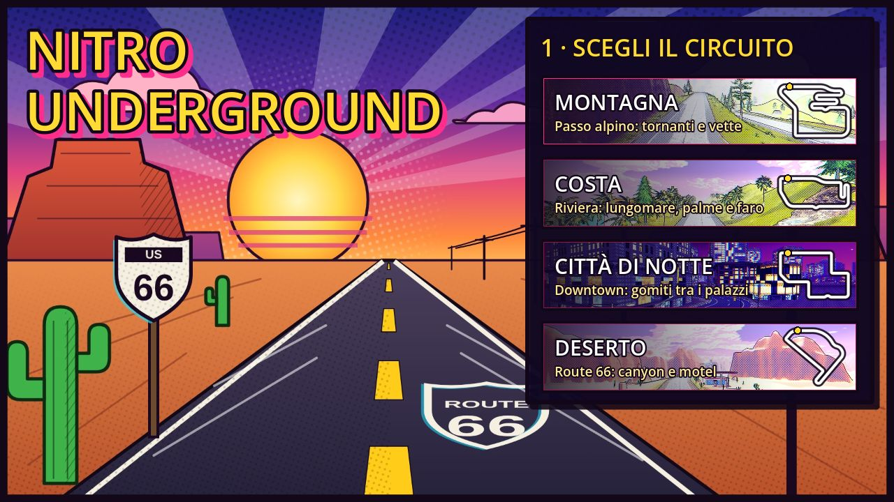
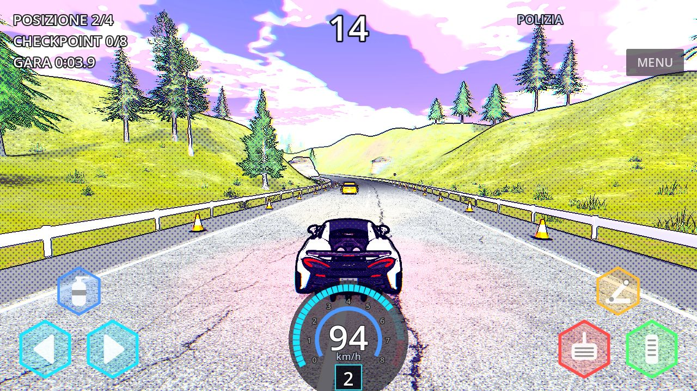
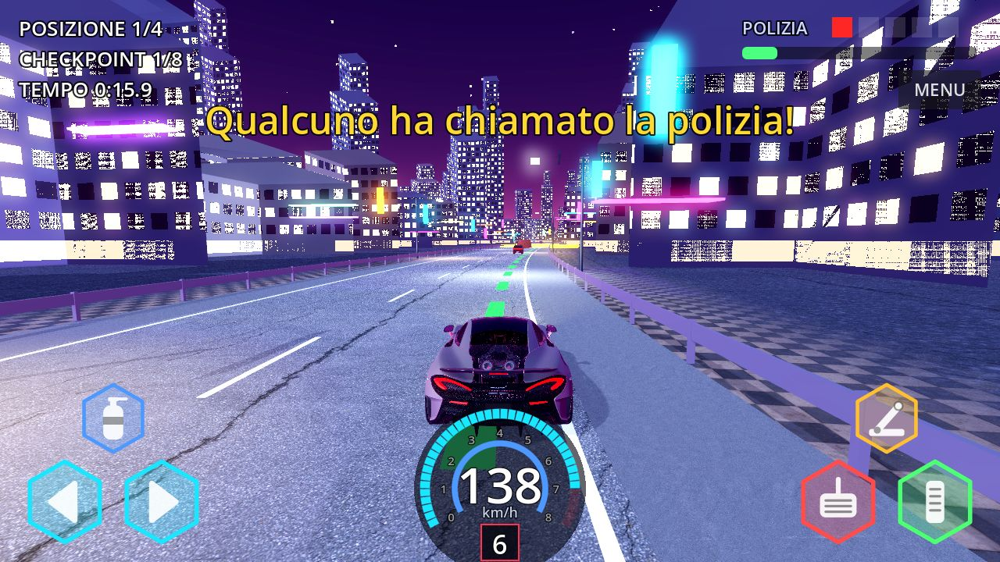
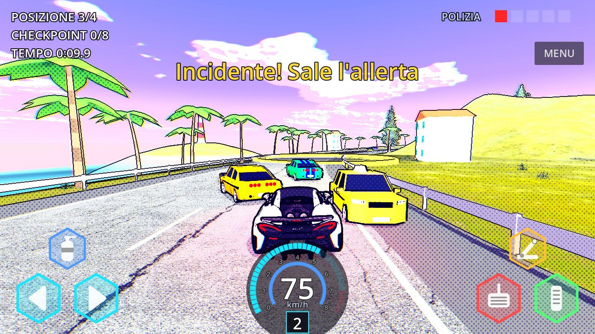
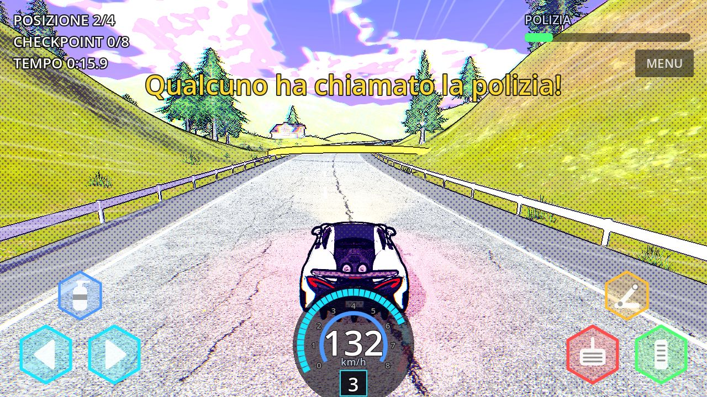
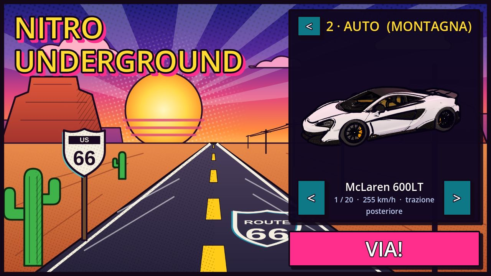

# Nitro Underground

**Gioco mobile di corse clandestine in 3D, con grafica a fumetto 2.5D.** Fatto con Godot 4, per Android.

> Versione attuale: **v0.11.1** (31 ottobre 2026) · Stato: prototipo giocabile, in sviluppo attivo
> 📖 [Storia completa dello sviluppo](docs/STORIA.md) · 🎨 [Crediti e licenze](CREDITI.md)

*English summary at the [bottom of the page](#english).*

---

## Che cos'è

Nitro Underground è un gioco di corse arcade per telefono, nello spirito delle gare clandestine
dei film e dei giochi di corse su strada degli anni 2000: auto sportive, sorpassi nel traffico,
nitro, derapate e la polizia che arriva se fai troppi danni. Nome, mondo e circuiti sono originali.

Il progetto è anche un esperimento: **Stefano**, l'autore, non scrive codice. Ha deciso lui il gioco,
lo stile, le auto e ogni modifica, provando ogni versione sul suo telefono Android e sul PC;
tutto il codice è stato scritto da Claude (l'assistente AI di Anthropic) seguendo le sue richieste.
La [storia dello sviluppo](docs/STORIA.md) racconta passo per passo come il gioco è cambiato,
versione dopo versione, in base alle sue prove.

## Screenshot

| | |
|---|---|
|  |  |
| *Montagna: tempo a scalare fino al prossimo checkpoint* | *Città di notte* |
|  |  |
| *Costa: lungomare, palme e traffico* | *Passo alpino con chalet e lavori in corso* |
|  |  |
| *Garage: scelta dell'auto* | *Le quattro ambientazioni della v0.11* |

## Cosa c'è nel gioco

- **4 circuiti**: Montagna (passo alpino con tornanti), Costa (riviera con palme e faro),
  Città di notte (downtown illuminato) e Deserto (Route 66 con canyon e motel).
- **Gara sprint** contro 3 avversari guidati dal computer, con checkpoint e **tempo a scalare**:
  ogni checkpoint ti dà qualche secondo in più, il tempo avanzato si somma.
- **Polizia**: se causi incidenti sale il livello di allerta e arrivano le volanti.
- **Garage con 7 auto**, ognuna con la sua velocità massima (210-255 km/h) e la sua trazione
  (anteriore, posteriore o integrale).
- **Fisica vera**: l'auto è un corpo rigido su quattro ruote con sospensioni; spinta e sterzo
  arrivano dalle ruote, ci sono salti con rampe e atterraggi, derapate col freno a mano,
  cambio automatico a 6 marce, nitro.
- **Traffico che si può urtare**: le auto civili vengono spinte, si girano e si incidentano.
  I guardrail si rompono a pezzi.
- **Audio delle auto**: motore V8 che segue i giri, cambiate con soffio del turbo,
  scoppiettii, gomme che stridono, nitro, urti e sirena.
- **Comandi touch** a esagoni con icone: sterzo e nitro a sinistra, gas, freno e freno a mano a destra.
  Cruscotto digitale con velocità, marcia e nitro, e linea di traiettoria a terra.
- **Stile grafico a fumetto 2.5D**: colori a bande, contorni a inchiostro, retino e tratteggio,
  cielo disegnato, sopra a modelli 3D di paesaggio realistici.
- **Circuiti scritti come testo**: ogni pista è un file in `tracks/` che si legge come
  un navigatore (`DRITTO 300`, `TORNANTE DESTRA`, `CHICANE`...). Chiunque può disegnarne una
  con il Blocco note: vedi [tracks/COME_FARE.md](tracks/COME_FARE.md).

## Come provarlo

### Su Android

Gli APK non sono nel repository (pesano circa 300 MB). Per ora vengono distribuiti a mano
per le prove. Chi ha l'APK lo copia sul telefono, lo apre e consente l'installazione da
"origini sconosciute". Se c'è già una versione precedente installata, va disinstallata prima,
perché ogni build è firmata con una chiave di prova diversa.

Per crearlo da sé: `GODOT=/percorso/godot tools/build_android.sh` produce `build/NitroUnderground.apk`
(servono i template di esportazione Android di Godot 4.7).

### Su PC Windows

1. Scarica [`tools/windows/Gioca-Nitro.bat`](tools/windows/Gioca-Nitro.bat) e
   [`tools/windows/gioca-nitro.ps1`](tools/windows/gioca-nitro.ps1) nella stessa cartella.
2. Fai doppio clic su `Gioca-Nitro.bat`.

La prima volta scarica Godot 4.7.2 e l'ultima versione di prova del gioco (ramo `prova-pc`),
prepara i modelli (5-10 minuti) e lo avvia. Le volte dopo riscarica solo se c'è una versione nuova.

| Tastiera | Azione |
|---|---|
| ← → oppure A D | Sterzo |
| ↑ oppure W | Gas |
| ↓ oppure S | Freno e retromarcia |
| Spazio | Freno a mano (derapata) |
| Shift oppure N | Nitro |

Il mouse fa da dito sui pulsanti a schermo.

### Dall'editor di Godot

Apri la cartella del progetto con **Godot 4.7** e premi Play. La scena iniziale è `scenes/menu.tscn`.

## Tecnologia

| | |
|---|---|
| Motore | Godot 4.7, renderer Mobile (Vulkan) |
| Fisica | Jolt Physics, 60 tick al secondo |
| Linguaggio | GDScript (circa 7.500 righe), shader Godot |
| Piattaforma | Android arm64; PC Windows per le prove |
| Asset | Gratuiti: CC0 e CC-BY (Poly Haven, Kenney, OpenGameArt, Freesound, Sketchfab) |

Quasi tutto è costruito dal codice: le scene `.tscn` sono minime, mentre strade, terreno,
guardrail, traffico, interfaccia e stile grafico nascono dagli script.

### Struttura del codice

| Cartella / file | Cosa contiene |
|---|---|
| `scripts/menu.gd` | Menu Route 66: scelta del circuito e dell'auto |
| `scripts/main.gd` | Regole di gara, checkpoint, tempo, polizia, telecamera, caricamento |
| `scripts/car.gd` | Auto `RigidBody3D`: ruote, sospensioni, cambio, nitro, salti, guida del computer |
| `scripts/car_catalog.gd` | Elenco delle auto, velocità massime, trazione, garage |
| `scripts/car_model.gd`, `car_audio.gd` | Modelli 3D delle auto e suoni del motore |
| `scripts/track.gd`, `track_layout.gd` | Base comune dei circuiti e lettura delle mappe in `tracks/*.txt` |
| `scripts/mountain.gd`, `coast.gd`, `night_city.gd`, `desert.gd` | Le quattro ambientazioni |
| `scripts/scenery.gd` | Piazza alberi, edifici e oggetti realistici a bordo strada |
| `scripts/traffic.gd`, `guardrails.gd`, `ramp.gd` | Traffico urtabile, guardrail che si rompono, rampe |
| `scripts/comic_style.gd`, `shaders/` | Lo stile a fumetto 2.5D |
| `scripts/hud.gd`, `dashboard.gd` | Comandi touch, cruscotto, schermate |
| `tracks/` | Le mappe dei circuiti in testo, con la guida `COME_FARE.md` |
| `tests/physics_bench.gd` | Banco prova della fisica (accelerazione, frenata, salti, urti) |
| `tools/` | Build Android, anteprima delle mappe, screenshot automatici, launcher per Windows |
| `docs/` | Storia dello sviluppo, immagini, guida per aggiornare la storia |

### Prove automatiche

- `godot --headless -s res://tests/physics_bench.gd -- --tps=60` misura accelerazione, frenata,
  curve, salti e urti, e stampa i risultati in JSON (da lanciare a 30, 60 e 120 tick per
  controllare che la fisica non dipenda dal frame rate).
- `godot --headless -- --autotest --mode=sprint` fa correre l'auto da sola per tutta la gara.
- `godot --headless --script tools/map_preview.gd -- <cartella>` disegna le mappe dei circuiti
  e controlla che i tratti di strada non si tocchino.

## Licenze, in breve

Gli asset vengono tutti da fonti gratuite e ognuno è registrato con autore e licenza in
[`assets/LICENSES.md`](assets/LICENSES.md). Alcuni modelli di auto (marchi reali, licenze
non commerciali) vanno bene per un prototipo e un portfolio ma **non** per una versione in vendita:
il riepilogo onesto è in [CREDITI.md](CREDITI.md).

Il codice non ha ancora una licenza open source: per ora tutti i diritti sono riservati all'autore.

## Roadmap

1. ~~Documento di concept~~ ✔
2. **Prototipo giocabile su telefono** ← siamo qui (v0.1 → v0.11.1)
3. Vertical slice: un circuito e un'auto rifiniti al livello del gioco finale
4. Produzione e pubblicazione sugli store (con sostituzione degli asset non commerciali)

---

## English

**Nitro Underground** is a mobile arcade street-racing game made with **Godot 4** for Android,
in a 2.5D comic-book art style. It is a work-in-progress prototype (v0.11.1, October 2026).

- 4 circuits (alpine pass, coast, night city, Route 66 desert), sprint races against 3 AI rivals,
  a countdown clock per checkpoint, police that arrive when you cause crashes.
- Rigid-body car physics with per-wheel grip and suspension, FWD/RWD/AWD, 6-speed gearbox,
  jumps, drifting, nitro; traffic you can crash into; breakable guardrails; full engine audio.
- Circuits are written as plain-text "turn-by-turn" files in `tracks/`, so anyone can design one.

The project's author, Stefano, does not write code: he designed the game and tested every build
on his phone, and all code was written by Claude (Anthropic's AI assistant) from his requests.
The [development history](docs/STORIA.md) (in Italian) follows every version from v0.1 to today.

Assets are free (CC0 / CC-BY, credited in [`assets/LICENSES.md`](assets/LICENSES.md)). Some car
models are real-brand or non-commercial (CC BY-NC) and are only used because this is a
non-commercial prototype/portfolio: see [CREDITI.md](CREDITI.md). The code has no open-source
licence yet (all rights reserved).
