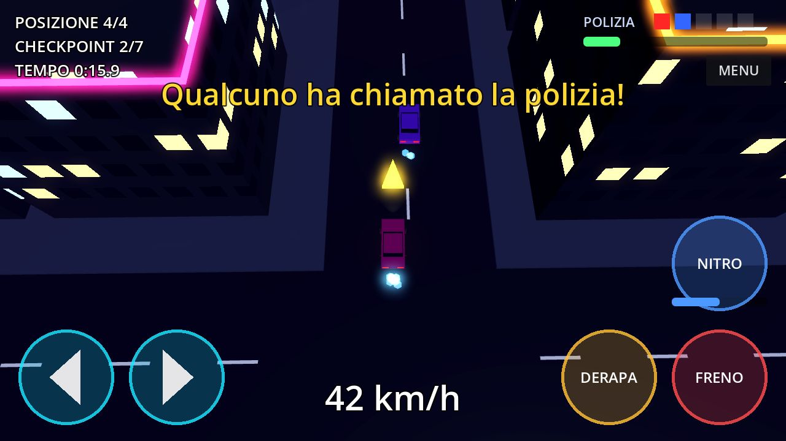
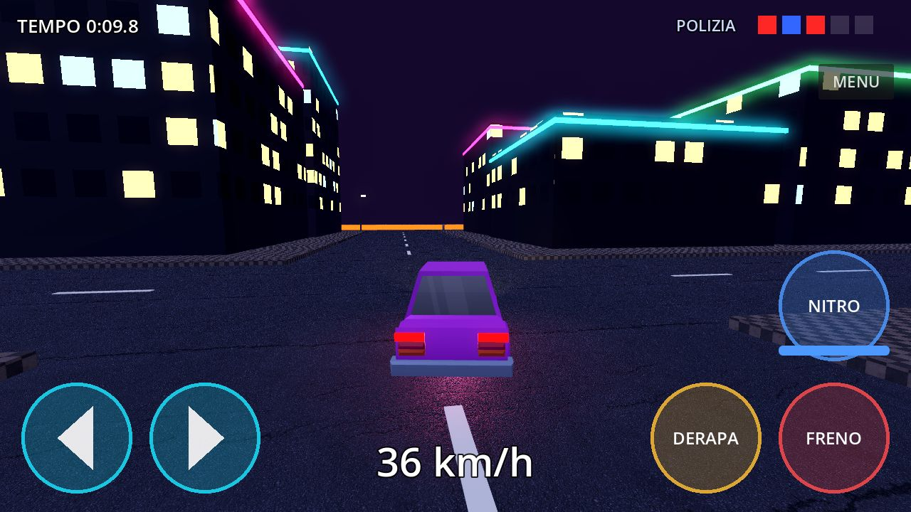
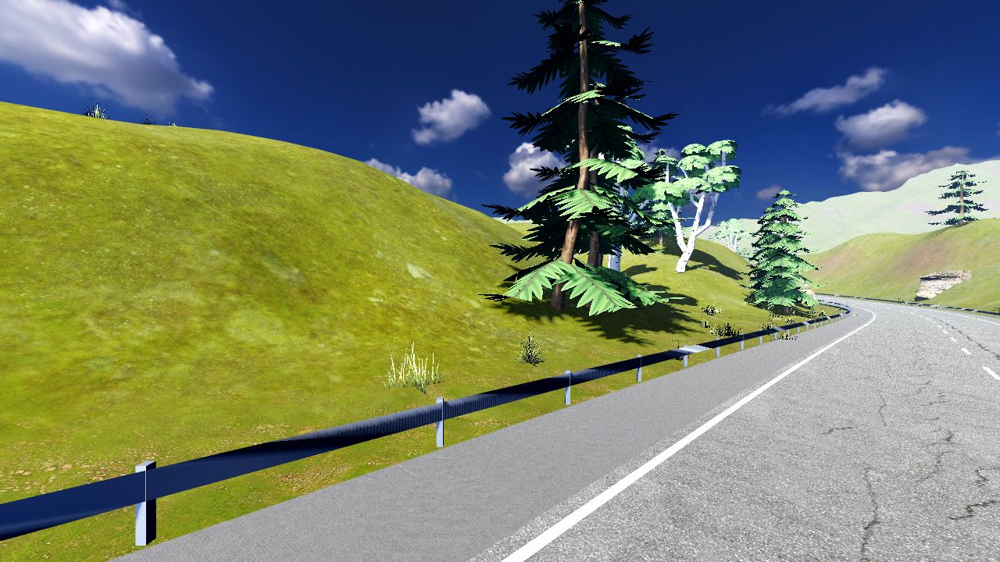
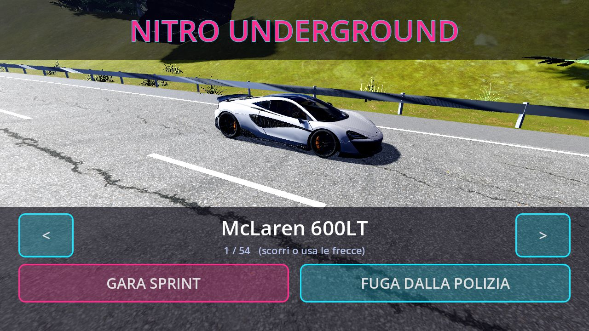
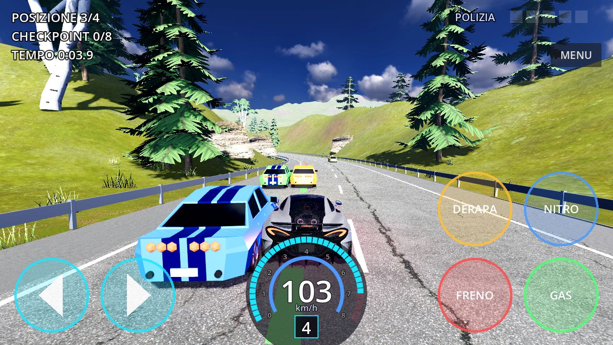
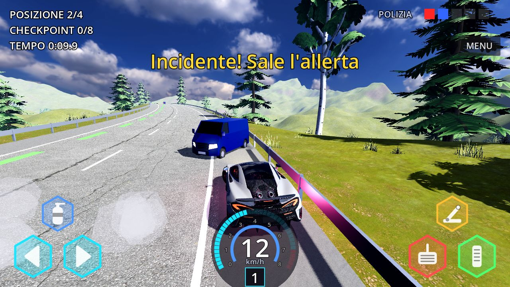
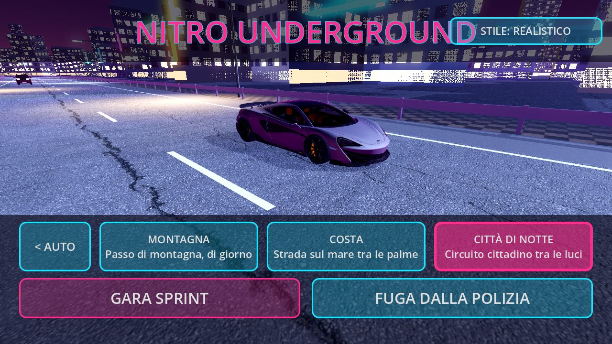
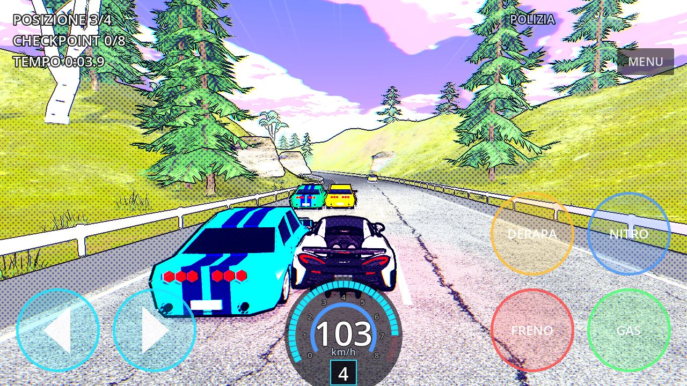
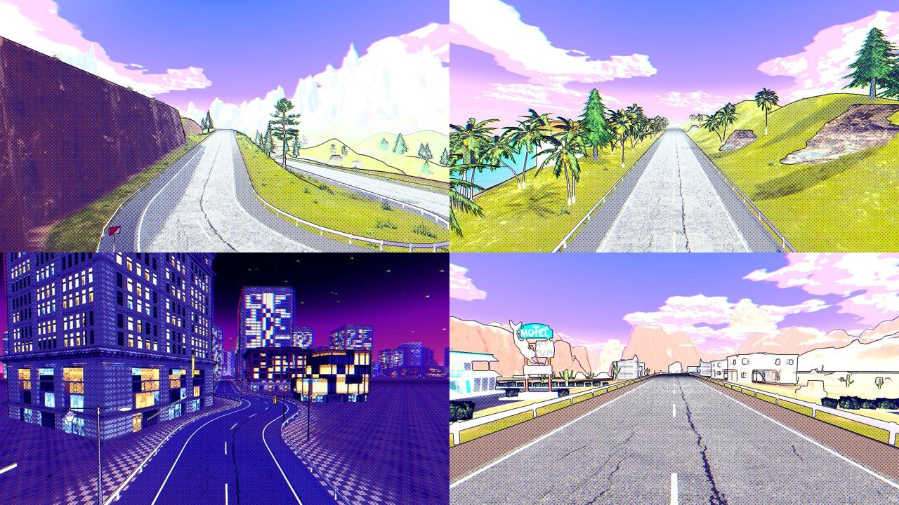
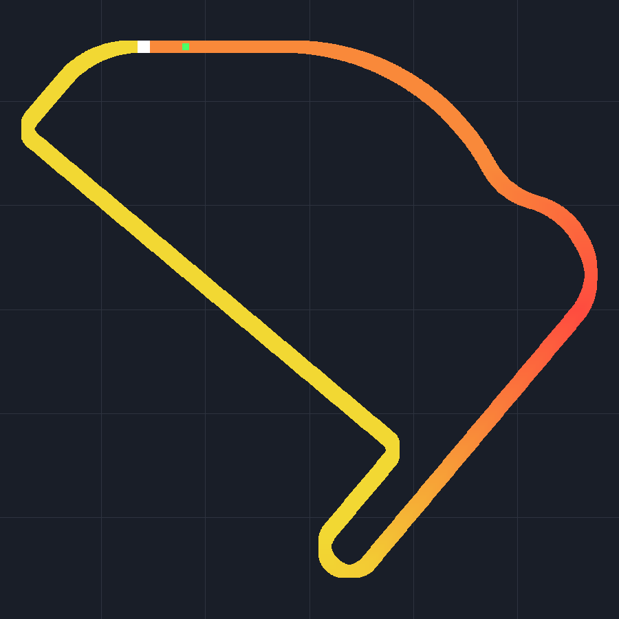

# Storia dello sviluppo

Il diario di bordo di Nitro Underground, dalla prima idea a oggi. Ogni voce dice **cosa ha chiesto
Stefano** dopo aver provato la versione precedente, **cosa è stato fatto** e dove trovarlo
(pull request su GitHub). Le voci più recenti sono in fondo.

Come si lavora: Stefano prova ogni versione sul suo telefono Android (APK) o sul PC Windows,
scrive cosa non va e cosa vuole; Claude scrive il codice, prepara la build e apre una pull request.
Le decisioni su stile, auto, circuiti e comandi sono tutte di Stefano.

> Per aggiungere una voce a fine sessione: [AGGIORNARE_LA_STORIA.md](AGGIORNARE_LA_STORIA.md).

## In sintesi

| Versione | Data | In una riga | PR |
|---|---|---|---|
| Concept | 27/10/2026 | L'idea, il piano in 4 passi, la scelta di Godot | — |
| v0.1 | 27/10/2026 | Primo prototipo: città notturna low poly, visuale dall'alto | — |
| v0.2 | 28/10/2026 | Nuova fisica: corpo rigido con ruote vere, Vulkan | [#1](https://github.com/stefanopaglierani/nitro-underground/pull/1), [#2](https://github.com/stefanopaglierani/nitro-underground/pull/2) |
| v0.3 | 29/10/2026 | Telecamera dietro l'auto, salti e rampe | [#3](https://github.com/stefanopaglierani/nitro-underground/pull/3), [#4](https://github.com/stefanopaglierani/nitro-underground/pull/4) |
| v0.4 | 29/10/2026 | Addio città buia: strada di montagna di giorno | [#5](https://github.com/stefanopaglierani/nitro-underground/pull/5), [#6](https://github.com/stefanopaglierani/nitro-underground/pull/6), [#7](https://github.com/stefanopaglierani/nitro-underground/pull/7) |
| v0.5 | 29/10/2026 | Garage nel menu, prime auto realistiche | [#8](https://github.com/stefanopaglierani/nitro-underground/pull/8) |
| v0.6 | 30/10/2026 | Struttura di guida: ruote, cruscotto, gas, guardrail | [#9](https://github.com/stefanopaglierani/nitro-underground/pull/9) |
| v0.7 | 30/10/2026 | Audio, traffico che si urta, comandi a esagoni, stile fumetto | [#10](https://github.com/stefanopaglierani/nitro-underground/pull/10), [#11](https://github.com/stefanopaglierani/nitro-underground/pull/11), [#12](https://github.com/stefanopaglierani/nitro-underground/pull/12) |
| v0.8 | 30/10/2026 | Marce lunghe, 20 auto, tre circuiti | [#13](https://github.com/stefanopaglierani/nitro-underground/pull/13), [#14](https://github.com/stefanopaglierani/nitro-underground/pull/14) |
| v0.9 | 31/10/2026 | Solo stile fumetto 2.5D, paesaggio realistico | [#10](https://github.com/stefanopaglierani/nitro-underground/pull/10) |
| v0.10 | 31/10/2026 | Menu Route 66, caricamento leggero, tempo a scalare | [#16](https://github.com/stefanopaglierani/nitro-underground/pull/16) |
| v0.11 | 31/10/2026 | Circuiti scritti come mappe, ambientazioni rifatte, Deserto | [#17](https://github.com/stefanopaglierani/nitro-underground/pull/17) |
| v0.11.1 | 31/10/2026 | Sterzo più dolce, niente ribaltamenti in aria, garage da 7 | [#17](https://github.com/stefanopaglierani/nitro-underground/pull/17) |

---

## Concept (27 ottobre 2026)

**L'idea di Stefano:** un gioco di corse per telefono da pubblicare un giorno su App Store e
Google Play. Arcade, 3D, nello spirito delle gare clandestine su strada: tuning, corse illegali,
inseguimenti della polizia. I riferimenti (film e giochi famosi del genere) servono solo come
ispirazione: nome, auto e mondo del gioco devono essere originali.

**Le scelte:**
- Stefano non programma, quindi tutto il codice lo scrive Claude.
- Motore **Godot 4**: le scene e gli script sono file di testo, si può costruire tutto senza
  aprire l'editor, ed è gratuito.
- Piano in 4 passi, approvato: 1) documento di concept, 2) prototipo da provare sul telefono
  ("guidare è divertente?"), 3) vertical slice, 4) produzione e pubblicazione.
- Budget zero: solo asset gratuiti.

## v0.1 — Il primo prototipo (27 ottobre)

Una città notturna di 6x6 isolati generata dal codice, con palazzi a finestre illuminate, neon e
traffico. Visuale dall'alto, auto arcade con accelerazione automatica, derapata e nitro.
Due modalità: **gara sprint** con 7 checkpoint contro 3 avversari e **fuga dalla polizia**.
Grafica low poly volutamente provvisoria.

**Risultato:** Stefano installa l'APK sul telefono e funziona. Primo traguardo raggiunto.

## v0.2 — Fisica vera (28 ottobre)

**Cosa ha chiesto Stefano:** un salto di qualità. Asset 3D più realistici e una fisica arcade
credibile: salti, atterraggi, urti, acrobazie. Prima viene fatta una revisione completa del
progetto, poi Stefano approva le scelte.

**Cosa è stato fatto:**
- L'auto diventa un `RigidBody3D` con **ruote a raggio** (sospensioni a molla, aderenza per ruota)
  e fisica Jolt. Nasce un banco prova automatico che misura accelerazione, frenata, curve e urti.
- Si passa al renderer Mobile (Vulkan).
- Primi asset CC0 da Poly Haven per la città: asfalto, cemento, mattoni, lampioni, cieli HDRI.

**Cosa ne ha pensato Stefano:** la fisica gli piace molto, gli scontri con le altre auto sono
"spettacolari", la derapata funziona. Ma la velocità non si sente e la frenata quasi non si nota.
E soprattutto: **la visuale dall'alto non rende**.

## v0.3 — Telecamera di inseguimento e salti (29 ottobre)

**Decisione di Stefano:** visuale dall'alto abbandonata per sempre. Ora la telecamera sta
dietro l'auto, vicina e un po' alta, per vedere l'auto e la strada lontano.

**Cosa è stato fatto:** telecamera di inseguimento, modelli di auto 3D KayKit (CC0) con vernice
riverniciabile, **rampe curve** nella città, controllo in volo, conteggio delle rotazioni e
atterraggi più morbidi.

## v0.4 — Dalla città di notte alla montagna di giorno (29 ottobre)

**Cosa ha chiesto Stefano:** la città notturna è troppo buia e le luci non convincono. Vuole una
**strada di montagna di giorno**, con luce piena e colori vivi, e un aspetto più realistico.

**Cosa è stato fatto:**
- Un anello di 2,7 km generato dal codice, con pendenze fino al 12%, guardrail, rocce,
  terreno e cielo di Poly Haven.
- Una libreria di modelli CC0 da OpenGameArt (Kenney, rgsdev, Quaternius e altri).
- Nuove auto rgsdev, pini e betulle veri, ciuffi d'erba. Gli avversari scansano il traffico.
- I circuiti diventano intercambiabili (una classe base `Track`).

## v0.5 — Il garage (29 ottobre)

**Cosa ha chiesto Stefano:** scegliere l'auto prima della gara, e auto **realistiche**, anche di
marchi veri. Lui stesso trova e scarica da Sketchfab una McLaren 600LT, un Ford F-150 Raptor R e
un RAM TRX.

**Decisione sulle licenze:** i modelli di auto di marchi reali e con licenza non commerciale vanno
bene finché il gioco è un prototipo e un portfolio. Se un giorno andrà sugli store, verranno
sostituiti. Ogni modello è registrato in `assets/LICENSES.md` proprio per questo.

**Cosa è stato fatto:** menu iniziale con garage a scorrimento di 54 veicoli.

## v0.6 — La struttura della guida (30 ottobre)

**Cosa ha chiesto Stefano** dopo aver provato la v0.4, in 11 punti: barra di caricamento (per
capire se il gioco sta lavorando o è bloccato), niente sterzo in aria, spinta e sterzo dalle ruote
(con trazione anteriore, posteriore e integrale diverse), telecamera a distanza sempre costante,
cruscotto digitale, **acceleratore manuale**, mondo chiuso (l'auto torna in pista se si allontana),
oggetti distruttibili, sospensioni che salgono sui gradini, linea di traiettoria a terra e
avversari più intelligenti.

**Cosa è stato fatto:** tutti e 11 i punti. Guardrail a tratti di 4 m che si staccano negli urti
forti, cartelli che volano via, linea tratteggiata verde/gialla/rossa per accelerare, mollare o frenare.

## v0.7 — Suoni, scontri e un nuovo stile (30 ottobre)

**Cosa ha chiesto Stefano:**
- Suoni che seguono l'auto: giri del motore, cambiate, freni, scontri.
- Il traffico restava fermo quando lo colpivi: vuole **scontri veri** e più traffico.
- Il nitro va spostato a sinistra, i pulsanti devono essere più piccoli, a esagono, con icone.
- Gli piace lo stile anime/cartoon e vuole provare un look **2.5D a fumetto**, come i film
  d'animazione recenti.

**Cosa è stato fatto:**
- Audio completo: motore V8 sintetizzato da zero (6 registri, a gas aperto e chiuso), cambiate
  con soffio del turbo, scoppiettii, gomme, nitro, vento, urti, sirena. Registrazioni CC0 da Freesound.
- Il traffico diventa fatto di corpi rigidi: si spinge, si gira, si incidenta. 24 auto civili.
- Comandi touch a esagoni con icone SVG.
- Primo stile a fumetto 2.5D, accanto a quello realistico e a quello anime, con un pulsante per cambiarlo.

## v0.8 — Velocità, garage e circuiti (30 ottobre)

**Cosa ha chiesto Stefano:** le marce sono troppo corte (le auto si fermano a 160 km/h): vuole
almeno 210 km/h in media, marce più lunghe e distanziate e un garage di **al massimo 20 auto**.
Poi: dopo l'auto, scegliere il circuito tra **Montagna, Costa e Città di notte**.

**Cosa è stato fatto:**
- Ogni auto ha la sua velocità massima (210-255 km/h). Misurato in pianura: McLaren 249 km/h,
  da 0 a 200 in 9,1 secondi.
- Garage di 20 auto approvato da Stefano, comprese le 4 che ha scaricato lui (Charger, Skyline R34,
  Porsche 911 GT3, Mustang 1969).
- Due nuovi circuiti: la Costa e una Città di notte, questa volta **luminosa**.

## v0.9 — Solo fumetto 2.5D (31 ottobre)

**Decisione di Stefano:** dopo aver provato i tre stili, il **fumetto 2.5D è l'unico stile** del
gioco. Gli altri e il pulsante per cambiarli vengono tolti. Per l'ambiente vuole i modelli più
realistici disponibili gratis, disegnati però in 2.5D.

**Cosa è stato fatto:** colori a bande, contorni a inchiostro, retino, tratteggio, cielo disegnato.
Alberi, chalet, cartelli e coni realistici da Sketchfab (CC-BY) lungo la strada.

## v0.10 — Menu Route 66 e caricamento leggero (31 ottobre)

**Cosa ha chiesto Stefano:** sul telefono il gioco si bloccava al 69% del caricamento ("luci e
ombre"). Vuole che non si carichi tutto all'avvio, un menu nuovo con lo sfondo **Route 66** in 2.5D,
un pannello unico (prima il circuito, poi l'auto, poi VIA!), tempo **a scalare** fino al prossimo
checkpoint, e niente più modalità fuga dalla polizia: resta solo la gara sprint.

**Cosa è stato fatto:**
- Nuovo menu con un'illustrazione originale della Route 66 (disegnata in SVG dal codice).
- Il gioco costruisce solo il circuito scelto; i modelli delle auto si caricano in parallelo.
- Trovate e corrette le probabili cause del blocco (un cielo che si ricalcolava a ogni fotogramma,
  un panorama 2K inutilizzato nell'APK).
- Cronometro a scalare: il tempo che avanza si somma al tratto successivo.

## v0.11 — Mappe dei circuiti e ambientazioni rifatte (31 ottobre)

**Cosa ha chiesto Stefano:** ambientazioni sensate e fatte bene (i palazzi della città di notte
erano "inguardabili"), una grande ricerca di modelli 3D per tutte le ambientazioni, circuiti molto
più vari (tornanti, gomiti, chicane, rettilinei) **o un modo per disegnarli lui**, e
un'immagine di sfondo su ogni pulsante dei circuiti.

**Cosa è stato fatto:**
- **I circuiti si scrivono come testo**: un pezzo di strada per riga (`DRITTO 300`,
  `TORNANTE DESTRA`, `CHICANE`, `SALITA`...), con una guida in italiano per Stefano
  ([tracks/COME_FARE.md](../tracks/COME_FARE.md)) e uno strumento che disegna la mappa e controlla
  che la strada non si sovrapponga.
- Città di notte ricostruita da zero con palazzi veri e finestre accese.
- Costa e nuovo circuito **Deserto** (Route 66 con paese, motel, distributore e canyon) arredati
  con modelli Sketchfab CC-BY.
- Una libreria di 58 modelli 3D divisa per ambientazione, per i prossimi lavori.
- Menu con l'immagine e la mappa di ogni circuito.

## v0.11.1 — Guida più dolce (31 ottobre)

**Cosa ha chiesto Stefano:** sterzo del giocatore più dolce del 30%, niente più muso che si
impenna quando si frena in aria, e un garage ridotto a 7 auto: McLaren 600LT, Porsche 911 GT3,
Mustang 1969, Skyline R34, Charger 1970, F-150 Raptor R e RAM TRX.

**Cosa è stato fatto:** sterzo del giocatore al 70% (gli avversari restano uguali), in aria i
pedali non girano più l'auto e la macchina si raddrizza da sola, garage da 7. Le auto escluse
restano nel repository ma non entrano nell'APK, che scende a circa 310 MB.

---

## Prossimi passi

- Prova sul telefono della v0.11.1 e messa a punto in base alle impressioni di Stefano.
- Passo 3 del piano: vertical slice, cioè un circuito e un'auto rifiniti al livello del gioco finale.
- Prima di qualsiasi pubblicazione: sostituire i modelli non commerciali e di marchi reali
  (vedi [CREDITI.md](../CREDITI.md)).
