# Storia dello sviluppo

Il diario di bordo di Nitro Underground, dalla prima idea alla v0.12, in 7 giorni e 13 versioni.

Ogni versione segue lo stesso ciclo: **Stefano prova la build** sul telefono Android o sul PC,
scrive cosa non va e cosa vuole, **Claude la costruisce** e la verifica con le prove automatiche,
poi la consegna come APK e come pull request. Per ogni voce trovi:

- **Richiesta**: cosa ha chiesto Stefano, spesso con le sue parole.
- **Come è stato costruito**: le soluzioni tecniche, con i file dove stanno.
- **Verifica ed esito**: come è stato controllato e cosa ne ha pensato Stefano alla prova.

Per l'architettura completa vedi [TECNICO.md](TECNICO.md). Le voci più recenti sono in fondo.

> Per aggiungere una voce a fine sessione: [AGGIORNARE_LA_STORIA.md](AGGIORNARE_LA_STORIA.md).

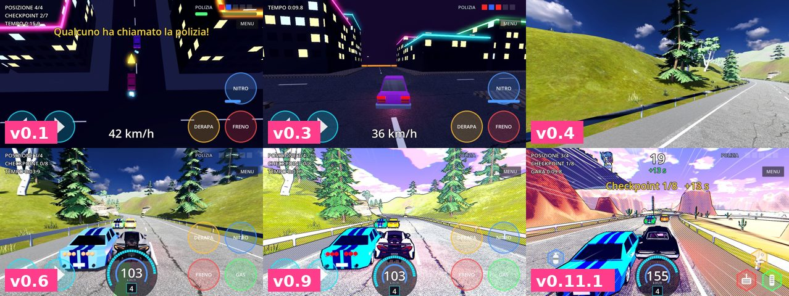

## In sintesi

| Versione | Data | In una riga | PR |
|---|---|---|---|
| Concept | 27/10/2026 | L'idea, il piano in 4 passi, la scelta di Godot | — |
| v0.1 | 27/10/2026 | Primo prototipo: città notturna low poly, visuale dall'alto | — |
| v0.2 | 28/10/2026 | Fisica nuova: corpo rigido su quattro ruote, Vulkan, banco prova | [#1](https://github.com/stefanopaglierani/nitro-underground/pull/1), [#2](https://github.com/stefanopaglierani/nitro-underground/pull/2) |
| v0.3 | 29/10/2026 | Telecamera dietro l'auto, rampe, salti e atterraggi | [#3](https://github.com/stefanopaglierani/nitro-underground/pull/3), [#4](https://github.com/stefanopaglierani/nitro-underground/pull/4) |
| v0.4 | 29/10/2026 | Dalla città buia alla strada di montagna di giorno | [#5](https://github.com/stefanopaglierani/nitro-underground/pull/5), [#6](https://github.com/stefanopaglierani/nitro-underground/pull/6), [#7](https://github.com/stefanopaglierani/nitro-underground/pull/7) |
| v0.5 | 29/10/2026 | Garage nel menu, prime auto realistiche | [#8](https://github.com/stefanopaglierani/nitro-underground/pull/8) |
| v0.6 | 30/10/2026 | Guida dalle ruote, trazioni diverse, cruscotto, guardrail che si rompono | [#9](https://github.com/stefanopaglierani/nitro-underground/pull/9) |
| v0.7 | 30/10/2026 | Audio del motore, traffico urtabile, comandi a esagoni, stile fumetto | [#10](https://github.com/stefanopaglierani/nitro-underground/pull/10), [#11](https://github.com/stefanopaglierani/nitro-underground/pull/11), [#12](https://github.com/stefanopaglierani/nitro-underground/pull/12) |
| v0.8 | 30/10/2026 | Marce lunghe e 210+ km/h, garage da 20, tre circuiti | [#13](https://github.com/stefanopaglierani/nitro-underground/pull/13), [#14](https://github.com/stefanopaglierani/nitro-underground/pull/14) |
| v0.9 | 31/10/2026 | Il fumetto 2.5D diventa l'unico stile, paesaggio realistico | [#10](https://github.com/stefanopaglierani/nitro-underground/pull/10) |
| v0.10 | 31/10/2026 | Menu Route 66, caricamento leggero, tempo a scalare | [#16](https://github.com/stefanopaglierani/nitro-underground/pull/16) |
| v0.11 | 31/10/2026 | Circuiti scritti come mappe di testo, ambientazioni rifatte, Deserto | [#17](https://github.com/stefanopaglierani/nitro-underground/pull/17) |
| v0.11.1 | 31/10/2026 | Sterzo più dolce, niente ribaltamenti in aria, garage da 7 | [#17](https://github.com/stefanopaglierani/nitro-underground/pull/17) |
| v0.12 | 02/11/2026 | Stabilizzazione: pausa, polizia più giusta, rivali e traffico più furbi | [#19](https://github.com/stefanopaglierani/nitro-underground/pull/19) |
| v0.13.1 | 04/11/2026 | Il telefono si bloccava: auto e texture alleggerite, addio fumetto 2.5D (grafica realistica di base), via i guardrail, nuova polizia | ramo `claude/project-thread-8bmj8s` |
| v0.14 | 05/11/2026 | OpenGL sul telefono, nuovo garage di 5 auto guidato anche dai rivali, traffico con 9 auto dettagliate, auto "pre-cotte" per un menù più veloce, via tutte le auto low poly | ramo `claude/project-thread-8bmj8s` |
| v0.15 | 06/11/2026 | Solo auto "vendibili" (CC BY): 14 nel garage e per i rivali, 4 volanti, 13 mezzi nel traffico; nomi inventati e loghi tolti alle auto di marchi reali | ramo `claude/project-thread-8bmj8s` |
| v0.16 | 06/11/2026 | Auto lontane in versione leggera contro gli scatti, asfalto a filo del terreno, avviso rosso di contromano, Petalo Roadster non più sospesa | ramo `claude/project-thread-8bmj8s` |
| v0.17 | 07/11/2026 | Si entra direttamente nel garage (3 auto, scelta definitiva, denaro e reputazione), minimappa in gara, caricamento con la serranda del garage che si apre | ramo `claude/project-thread-v3cjse` |
| v0.18 | 07/11/2026 | Pagina d'attesa con START, denaro e reputazione che si guadagnano in gara, asfalto 10 cm sopra il terreno, traiettoria semitrasparente | ramo `claude/project-thread-v3cjse` |
| v0.19 | 08/11/2026 | Dealer con 14 auto, colore RGB ed elaborazioni a 5 livelli; nuova combo delle derapate; dopo la Costa la Città | ramo `claude/project-thread-v3cjse` |

## Le svolte principali

Il gioco di oggi è molto diverso dall'idea del primo giorno. Le svolte sono nate tutte dalle prove
di Stefano sul telefono:

1. **Dalla visuale dall'alto alla telecamera di inseguimento** (v0.3): dall'alto "non rende" e
   non dà il senso della velocità.
2. **Dalla città di notte buia alla montagna di giorno** (v0.4), e poi ritorno a una città di
   notte, ma **luminosa** (v0.8) e ricostruita con palazzi veri (v0.11).
3. **Dal low poly al fumetto 2.5D** (v0.7-v0.9): provati tre stili affiancati nello stesso gioco,
   scelto quello a fumetto come unico.
4. **Da circuiti generati con formule a circuiti scritti come mappe** (v0.11): ora i circuiti li
   può disegnare chiunque, anche senza programmare.
5. **Da 54 auto a 7** (v0.5 → v0.11.1): meno auto, ma dettagliate e scelte una per una.

---

## Concept (27 ottobre 2026)

**Richiesta:** un gioco di corse per telefono da pubblicare un giorno su App Store e Google Play.
Arcade, 3D, nello spirito delle gare clandestine su strada: tuning, corse illegali, inseguimenti
della polizia. I grandi titoli del genere sono solo un riferimento: nome, auto e mondo del gioco
devono essere originali.

**Scelte fatte:**
- **Godot 4** invece di Unity: gratuito, leggero sul telefono, e scene e script sono file di
  testo, quindi tutto si può costruire e rivedere senza aprire l'editor.
- **Tutto il codice lo scrive Claude**, Stefano decide e prova. Budget zero: solo asset gratuiti.
- **Piano in 4 passi**, approvato: 1) documento di concept, 2) prototipo da provare sul
  telefono ("guidare è divertente?"), 3) vertical slice, 4) produzione e pubblicazione.

## v0.1 — Il primo prototipo (27 ottobre)

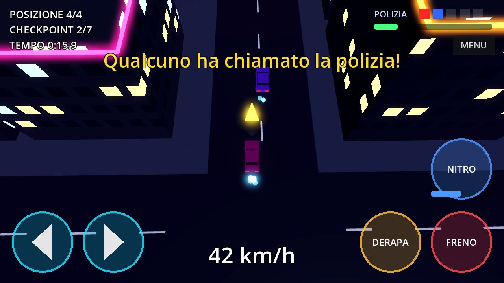

**Richiesta:** una prima versione da installare sul telefono, per capire se guidare è divertente.

**Come è stato costruito:**
- Città di 6×6 isolati **generata dal codice** (`city.gd`): strade, palazzi con uno shader che
  accende finestre a caso sulle facciate (`building.gdshader`), neon, lampioni.
- Auto arcade su `CharacterBody3D` (movimento calcolato dal codice, senza fisica dei corpi rigidi), con accelerazione
  automatica, derapata col freno a mano e nitro che si ricarica derapando.
- Avversari e polizia che seguono percorsi lungo le strade; traffico civile.
- Due modalità: **gara sprint** (7 checkpoint, 3 avversari) e **fuga dalla polizia** (stare a più
  di 110 m da tutte le volanti per 10 secondi), con livello di allerta che sale con gli incidenti.
- Una prova automatica (`--autotest`) fa guidare l'auto da sola per tutta la gara: è stata la
  base di tutti i controlli successivi.
- Script di build Android (`tools/build_android.sh`), eseguito in un container cloud senza Android SDK
  ufficiale, con un firmatario APK fatto apposta.

**Esito:** Stefano installa l'APK sul telefono e funziona. Primo traguardo raggiunto.

## v0.2 — Fisica vera (28 ottobre)

**Richiesta:** un salto di qualità: asset più realistici e una fisica arcade credibile, con salti,
atterraggi, urti e acrobazie. Prima viene fatta una revisione completa del progetto; Stefano
approva le scelte e l'ordine dei lavori.

**Come è stato costruito:**
- L'auto diventa un **`RigidBody3D`** con fisica **Jolt**: quattro ruote simulate con
  sospensioni a molla-smorzatore e aderenza per ruota limitata dal carico (`car.gd`).
- Passaggio al **renderer Mobile (Vulkan)**.
- **Banco prova della fisica** (`tests/physics_bench.gd`): misura accelerazione, frenata, curve,
  derapata, urto contro un muro e stampa i risultati in JSON, a 30, 60 e 120 tick al secondo
  per controllare che la fisica non dipenda dal frame rate.
- Primi asset **CC0 da Poly Haven**: cieli HDRI, asfalto, cemento, mattoni, lampioni, con un
  registro delle licenze (`assets/LICENSES.md`) avviato da subito.

**Esito:** la fisica gli piace molto, gli scontri con le altre auto sono "spettacolari", la
derapata funziona. Ma la velocità non si sente, la frenata quasi non si nota e soprattutto
**la visuale dall'alto non rende**.

## v0.3 — Telecamera di inseguimento e salti (29 ottobre)

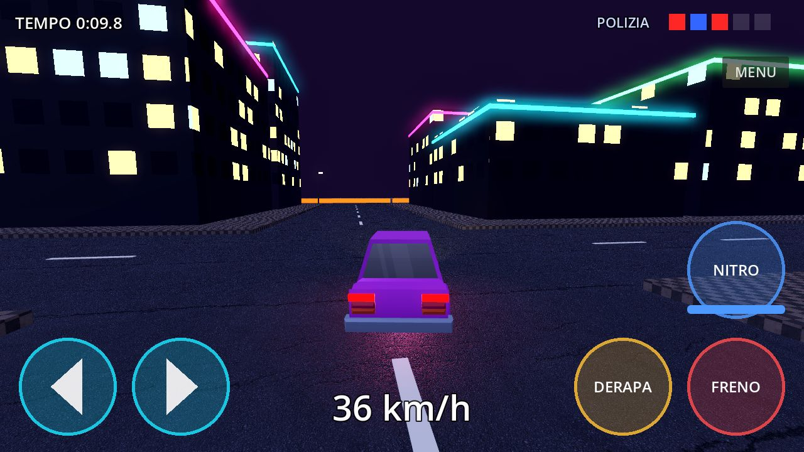

**Richiesta:** visuale dall'alto abbandonata per sempre. Telecamera dietro l'auto, vicina e un po'
alta, per vedere l'auto e la strada lontano.

**Come è stato costruito:**
- **Telecamera di inseguimento** a distanza costante, che guarda un punto davanti all'auto;
  il campo visivo si allarga un poco col nitro.
- Auto 3D **KayKit (CC0)** con vernice riverniciabile da shader (`car_paint.gdshader`) e luci.
- **Rampe curve** (`ramp.gd`) con raccordo all'inizio, segnali di decollo e atterraggio,
  conteggio delle rotazioni in aria e atterraggi più morbidi.
- Il banco prova confronta la lunghezza dei salti con la **traiettoria balistica teorica**
  (`d = v² sin 2θ / g`): oggi lo scarto è di circa il 2%.

## v0.4 — Dalla città di notte alla montagna di giorno (29 ottobre)

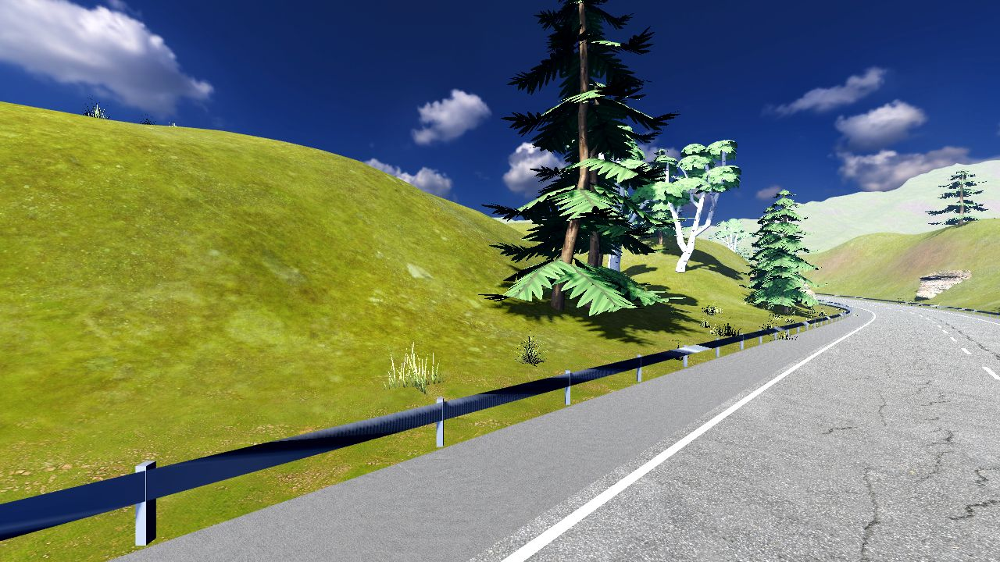

**Richiesta:** la città notturna è troppo buia e le luci non convincono. Una **strada di montagna
di giorno**, con luce piena, colori vivi e un aspetto più realistico.

**Come è stato costruito:**
- Una classe base **`Track`** separa il circuito dal resto del gioco: regole di gara, IA e
  traffico usano solo la sua interfaccia, così i livelli diventano intercambiabili.
- **`Mountain`** (`mountain.gd`): anello chiuso di 2,7 km generato da semi fissi (uguale a ogni
  partita), pendenze fino al 12%, carreggiata a due corsie, **terreno a blocchi** raccordato alla
  strada con uno shader che miscela erba e roccia, pareti di roccia dove la strada taglia il pendio,
  guardrail su entrambi i lati, cielo e rocce di Poly Haven.
- **Velocità consigliata in curva** calcolata dal raggio della strada: gli avversari la usano
  per frenare prima delle curve.
- Una **libreria di modelli CC0** da OpenGameArt (Kenney, rgsdev, Quaternius, Yughues e altri),
  tenuta fuori dall'APK con un file `.gdignore`.
- Auto rgsdev, pini e betulle Quaternius, ciuffi d'erba Yughues. Gli avversari scansano il traffico.

## v0.5 — Il garage (29 ottobre)

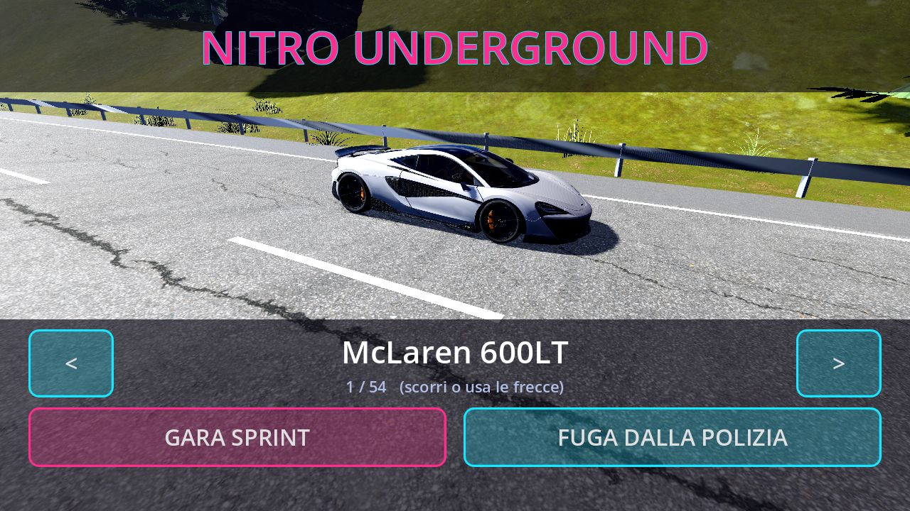

**Richiesta:** scegliere l'auto prima della gara, e auto **realistiche**, anche di marchi veri.
Stefano stesso trova e scarica da Sketchfab una McLaren 600LT, un Ford F-150 Raptor R e un RAM TRX.

**Come è stato costruito:**
- **`CarCatalog`**: un catalogo di 54 veicoli con nome, modello e proprietà, e un menu iniziale
  con garage a scorrimento.
- **`CarModel.build_generic`**: carica qualsiasi modello glTF, ne trova da solo davanti e dietro
  (dai nomi di mesh e materiali), lo scala alla lunghezza reale, lo appoggia a terra e collega le
  ruote anteriori allo sterzo quando sono oggetti separati.

**Decisione sulle licenze:** i modelli di marchi reali e con licenza non commerciale vanno bene
finché il gioco è un prototipo e un portfolio; prima di una pubblicazione verranno sostituiti.
Sono tutti dichiarati in [CREDITI.md](../CREDITI.md).

## v0.6 — La struttura della guida (30 ottobre)

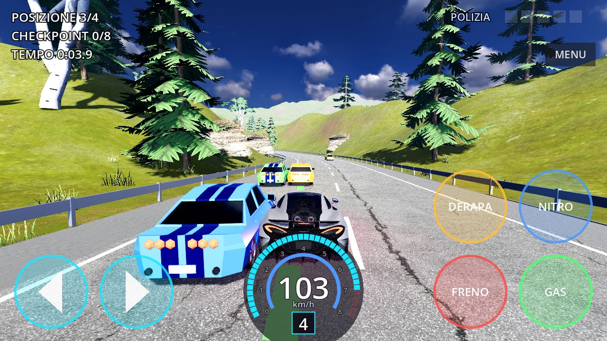

**Richiesta**, in 11 punti dopo la prova della v0.4: barra di caricamento (per capire se il gioco
lavora o è bloccato), niente sterzo in aria, spinta e sterzo dalle ruote con trazione anteriore,
posteriore e integrale diverse, telecamera a distanza sempre costante, cruscotto digitale,
**acceleratore manuale**, mondo chiuso, oggetti distruttibili, sospensioni che salgono sui
gradini, linea di traiettoria a terra e avversari più intelligenti.

**Come è stato costruito:** tutti e 11 i punti.
- **Ruote come cilindri proiettati** (shape cast) invece di raggi: salgono su un cordolo da
  15 cm anche a 90 km/h invece di sbatterci.
- **Spinta solo dalle ruote motrici** e ruote anteriori che sterzano davvero; trazione per auto in
  `CarCatalog` (`front_drive` da 0 a 1). Angolo di sterzo che si stringe con la velocità.
- **Cambio automatico a 6 marce** con giri motore; **cruscotto digitale** (`dashboard.gd`) con
  contagiri, velocità, marcia e nitro.
- **Guardrail distruttibili** (`guardrails.gd`): tratti da 4 m disegnati con MultiMesh e raggruppati
  in pochi corpi fisici; un urto oltre una soglia stacca il tratto e il palo, che volano via come
  pezzi liberi. I cartelli delle curve sono corpi appoggiati che un'auto fa volare.
- **Traiettoria ideale** tracciata sull'asfalto a trattini verdi (accelera), gialli (molla) e rossi
  (frena), calcolata con il metodo descritto in [TECNICO.md](TECNICO.md#5-circuiti-scritti-come-mappe-di-testo).
- **Mondo chiuso**: chi resta oltre il guardrail per 3 secondi torna in strada.

## v0.7 — Suoni, scontri e un nuovo stile (30 ottobre)

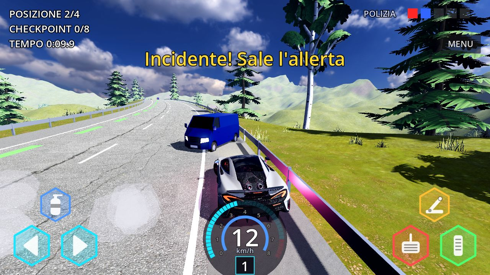

**Richiesta:**
- Suoni che seguono l'auto: giri del motore, cambiate, freni, scontri.
- Il traffico restava fermo quando lo colpivi: **scontri veri** e più traffico.
- Nitro a sinistra, pulsanti più piccoli, a esagono, con icone.
- Gli piace lo stile anime/cartoon e vuole provare un look **2.5D a fumetto**.

**Come è stato costruito:**
- **Audio** (`car_audio.gd`): motore V8 **sintetizzato da zero** in Python
  (`tools/audio/make_engine_sounds.py`), 6 anelli a gas aperto e 6 a gas chiuso, miscelati e
  intonati ai giri a ogni fotogramma. Cambiate con soffio del turbo, scoppiettii, gomme, nitro,
  vento, urti di tre intensità, sirena; registrazioni CC0 da Freesound tagliate da script.
  Verificato registrando un video della partita.
- **Traffico come corpi rigidi** (`traffic.gd`): una spinta limitata li tiene in corsia, un urto più
  forte li sposta, uno molto forte li fa girare e sbandare. 24 auto. Livelli di collisione
  separati, perché in Jolt una collisione "a senso unico" trasforma l'auto colpita in un muro.
- **Comandi touch a esagoni** disegnati in SVG alla dimensione dello schermo.
- **Tre stili grafici affiancati** (realistico, anime, fumetto 2.5D) con un pulsante per cambiarli,
  così Stefano poteva confrontarli sul telefono.

## v0.8 — Velocità, garage e circuiti (30 ottobre)

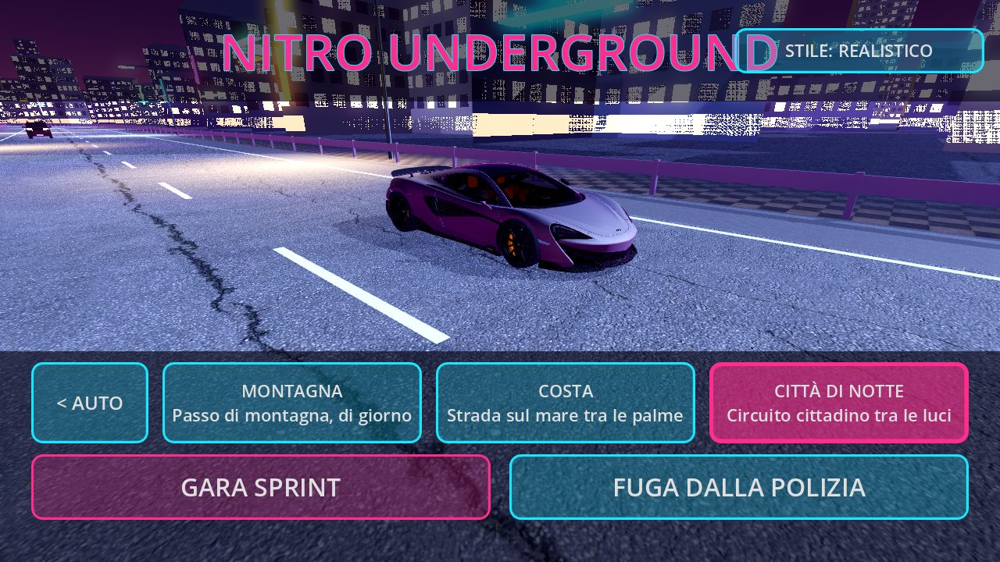

**Richiesta:** le marce sono troppo corte (le auto si fermano a 160 km/h): almeno 210 km/h,
marce più lunghe e distanziate, garage di **al massimo 20 auto**. Poi, dopo l'auto, scegliere il
circuito tra **Montagna, Costa e Città di notte**.

**Come è stato costruito:**
- **Velocità massima per auto** (210-255 km/h) in `CarCatalog`; rapporti allungati
  (`GEAR_TOPS`) con forza che cala nelle marce alte (`forza ~ rapporto^0,55`). Misurato in pianura:
  McLaren 249 km/h, da 0 a 200 in 9,1 secondi.
- **Garage da 20 auto** approvato da Stefano, comprese 4 che ha scaricato lui.
- **Costa** (`coast.gd`) e **Città di notte** (`night_city.gd`) come sottoclassi di `Mountain` che
  ridefiniscono solo forma, terreno, materiali e decorazioni. La città, stavolta, è **luminosa**:
  luce ambiente forte, finestre accese, pozze di luce sull'asfalto, neon e 8 luci vere che
  seguono la telecamera.

## v0.9 — Solo fumetto 2.5D (31 ottobre)

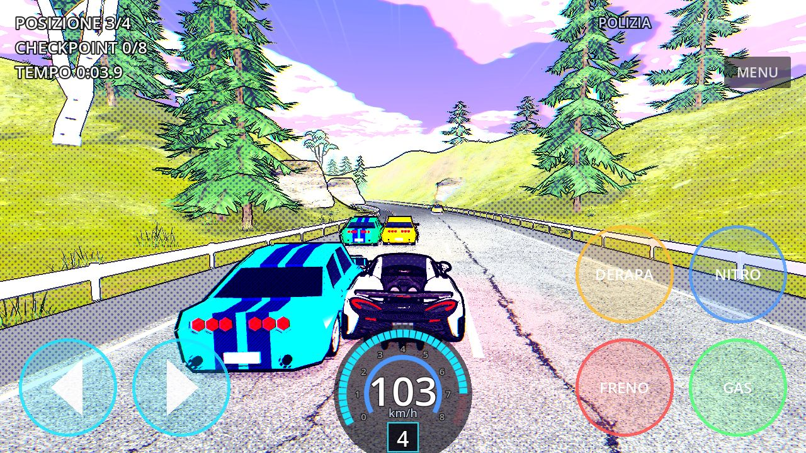

**Richiesta:** dopo aver provato i tre stili, il **fumetto 2.5D è l'unico stile** del gioco. Per
l'ambiente, i modelli più realistici disponibili gratis, ma disegnati in 2.5D.

**Come è stato costruito:**
- **`ComicStyle`** (`comic_style.gd`): converte in luce toon ogni materiale che entra in scena,
  anche dopo (auto, detriti), aggiunge un contorno a inchiostro alle auto e una **passata a schermo
  intero** (`stylize.gdshader`) con bande di colore, linee d'inchiostro sui salti di profondità,
  retino, tratteggio e lastre di colore sfasate. Cielo pop-art e linee di velocità.
- **`Scenery`** (`scenery.gd`): alberi, chalet, cartelli, coni e barriere realistici da Sketchfab
  (CC BY), scalati all'altezza reale e piazzati lungo la strada; lavori in corso con coni.

## v0.10 — Menu Route 66 e caricamento leggero (31 ottobre)

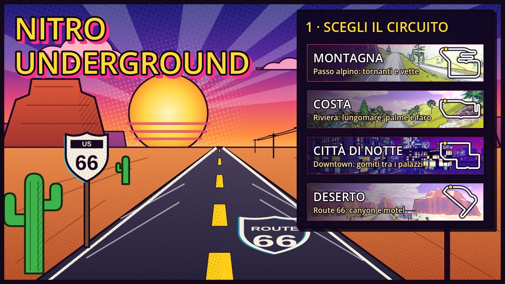

**Richiesta:** sul telefono il gioco si bloccava al 69% del caricamento ("luci e ombre"). Non
caricare tutto all'avvio; un menu nuovo con lo sfondo **Route 66** in 2.5D, un pannello unico
(prima il circuito, poi l'auto, poi VIA!); tempo **a scalare** fino al prossimo checkpoint; niente
più fuga dalla polizia, resta la gara sprint.

**Come è stato costruito:**
- **Menu** come scena separata (`menu.gd`) con un'illustrazione **originale** della Route 66
  disegnata in SVG (`tools/art/route66.svg`) e trasformata in immagine con Chromium.
- **Caricamento a passi**: si costruisce solo il circuito scelto, i modelli delle auto vengono letti
  **in thread paralleli** mentre si costruisce il livello, il 3D è spento finché il livello non è
  pronto e la barra avanza a ogni passo.
- **Cause del blocco** trovate nel codice e corrette: un cielo che ricalcolava la mappa dei riflessi
  a ogni fotogramma e un panorama 2K inutilizzato che finiva nell'APK.
- **Tempo a scalare**: ogni checkpoint aggiunge il tempo per arrivare al successivo, il tempo avanzato
  si somma; "+N s" sotto il cronometro, che diventa giallo sotto 10 secondi e rosso lampeggiante sotto 5.

## v0.11 — Mappe dei circuiti e ambientazioni rifatte (31 ottobre)

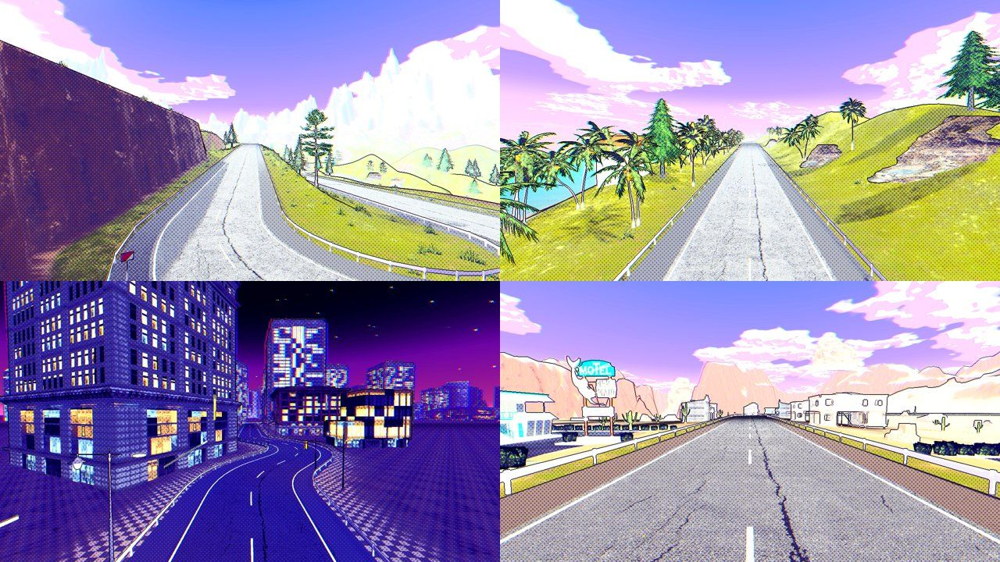

**Richiesta:** ambientazioni sensate e fatte bene (i palazzi della città di notte erano
"inguardabili"), una grande ricerca di modelli 3D, circuiti molto più vari (tornanti, gomiti,
chicane, rettilinei) **o un modo per disegnarli da sé**, e un'immagine su ogni pulsante dei circuiti.

**Come è stato costruito:**
- **Linguaggio delle mappe** (`track_layout.gd`): un pezzo di strada per riga, in italiano
  (`DRITTO 300`, `TORNANTE DESTRA`, `CHICANE SINISTRA`, `SALITA 4`...). L'anello si chiude da solo
  ritoccando curve e rettilinei. Guida per non programmatori in [tracks/COME_FARE.md](../tracks/COME_FARE.md).
- **Controllo delle mappe** (`tools/map_preview.gd`): disegna ogni circuito e misura la distanza
  minima tra due tratti di strada, per scoprire sovrapposizioni prima di giocare.
- **Città di notte ricostruita** con palazzi veri (Sketchfab, CC BY) e uno shader che accende le
  finestre; skyline di torri, semafori agli incroci, neon sulle vetrine.
- **Nuovo circuito Deserto** (`desert.gd`): Route 66 con lunghissimo rettilineo, canyon di roccia
  rossa, tornante e un paese con distributore, motel con insegna, banca e torre dell'acqua.
- **Ottimizzazione**: `Scenery` fonde i pezzi di ogni modello in una mesh con una superficie per
  materiale (un modello da 123 pezzi passava da oltre 1.000 chiamate di disegno a poche); texture
  compresse per la GPU a 512 px.
- **Libreria di 58 modelli** divisa per ambientazione, per i prossimi lavori; il tempo dei
  checkpoint ora viene dal tempo ideale sulla traiettoria (× 1,55 + 4 s).

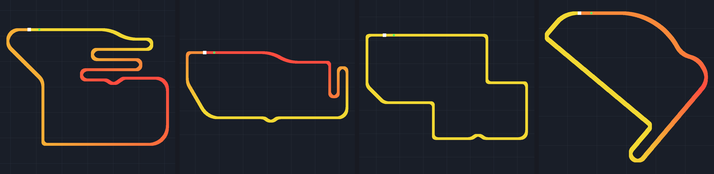

## v0.11.1 — Guida più dolce (31 ottobre)

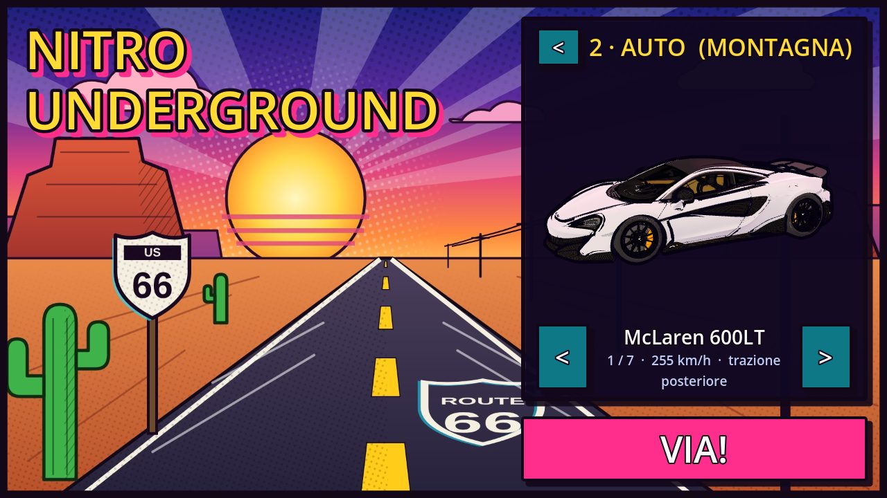

**Richiesta:** sterzo del giocatore più dolce del 30%, niente più muso che si impenna quando si
frena in aria, e un garage di 7 auto: McLaren 600LT, Porsche 911 GT3, Mustang 1969, Skyline R34,
Charger 1970, F-150 Raptor R e RAM TRX.

**Come è stato costruito:** un coefficiente di sterzo solo per il giocatore (`PLAYER_STEER = 0.7`,
gli avversari restano uguali); in aria i pedali non ruotano più l'auto, che si raddrizza da sola;
garage da 7. Le auto escluse restano nel repository ma i filtri di esportazione le lasciano fuori
dall'APK, che scende a circa 310 MB.

**Verifica:** banco prova della fisica a 60 tick: 0-100 km/h in 3,48 s, frenata da 144 km/h in
62,9 m, salti entro il 2-2,5% della traiettoria balistica, atterraggi con 2-3° di inclinazione.

## v0.12 — Stabilizzazione: pausa, polizia, rivali e traffico (2 novembre)

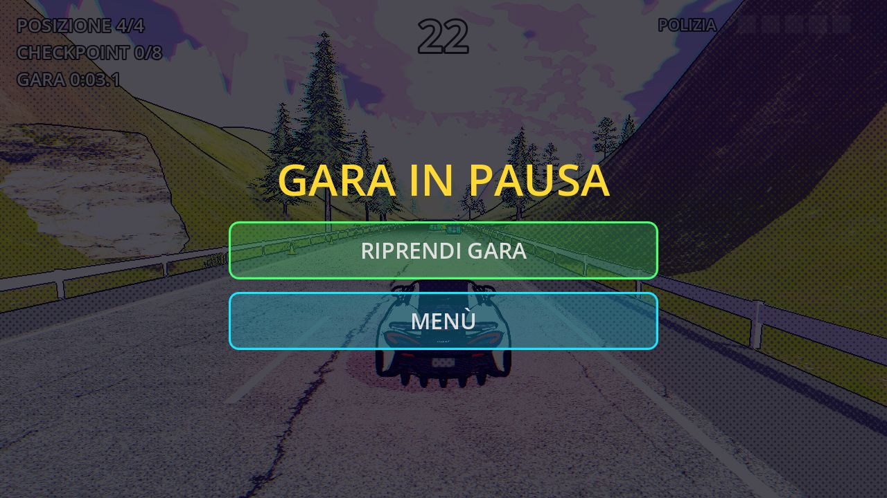

**Richiesta:** il 2 novembre Stefano ha fissato una direttiva di sviluppo: prima di aggiungere
cose nuove, **rendere stabile il gioco che c'è**. Dopo un controllo completo della v0.11.1 (codice,
prove automatiche, gara su tutti i circuiti) ha scelto le correzioni: una pausa vera, una polizia
meno esagerata ("arriva a 20 secondi e prima si occupa delle auto in gara che incontra"), rivali
più veloci del 20% e più attenti agli incidenti, e un traffico che dopo un urto si ferma
3 secondi e poi si libera da solo.

**Come è stato costruito:**
- **Pausa** (`hud.gd`, `main.gd`): pannello "GARA IN PAUSA" con *Riprendi gara* e *Menù*. Si apre
  con il pulsante MENU, con il tasto Indietro di Android (che prima chiudeva il gioco di colpo) e
  da sola quando il telefono manda il gioco in secondo piano (una chiamata, il tasto Home). Tutto si
  ferma: cronometro, auto, fisica. Nel menu, Indietro torna dalle auto ai circuiti.
- **Posizione in gara**: la scritta POSIZIONE poteva bloccarsi per tutta la gara se il giocatore
  saltava un punto del percorso (per esempio passando da un guardrail rotto); ora guarda anche i
  punti successivi.
- **Polizia**: chiamata a 20 secondi invece di 14; ogni volante insegue la prima auto in gara che
  incontra e passa al giocatore solo quando lui le passa vicino (35 m); arresto solo se fermo sotto
  i 5 km/h accanto alla polizia per 5 secondi.
- **Rivali** (`car.gd`, `main.gd`): +20% di velocità massima e spinta, curve prese al 92% della
  velocità consigliata, traffico guardato più lontano; se restano incastrati 8 secondi vengono
  rimessi sul percorso.
- **Traffico** (`traffic.gd`): qualsiasi urto da un'auto in gara ferma l'auto civile per
  3 secondi (si può ancora spingere); poi riparte da sola: se ha un'auto attaccata davanti fa un
  po' di retromarcia, la aggira di lato piano e torna in corsia.
- **Telecamera** (`main.gd`): alzata e allontanata del 20% (con i pickup l'auto copriva la strada);
  solo muri e rocce la fanno avvicinare, non più le auto che seguono, e mai a meno di 4 m.

**Verifica:** banco prova della fisica a 30, 60 e 120 tick con gli stessi numeri della v0.11.1
(la guida non è cambiata). La gara automatica, che con la v0.11.1 finiva sempre con l'arresto,
ora arriva al traguardo su tutti e 4 i circuiti. Pausa, Indietro, secondo piano, urti col traffico
e posizione in gara sono stati provati con script di prova. Da provare sul telefono.

## v0.13.1 — Il telefono si blocca: si torna alla grafica realistica (4 novembre)

**Richiesta:** Stefano ha provato la v0.12 sul suo Samsung Galaxy A51: al passo di caricamento
"Luci e ombre" il gioco restava fermo quasi 60 secondi e poi si chiudeva; anche l'anteprima
dell'auto nel menù era lenta. Dopo due tentativi di alleggerimento ha preso una decisione
"drastica, con effetto immediato": **via tutta la grafica 2.5D e cartoon, ritorno alle origini con
grafica realistica**, partendo da una versione con le impostazioni grafiche di base, senza filtri.
Nella stessa sera ha chiesto di **togliere i guardrail** ("danno veramente fastidio"), di eliminare
la Mustang 1969 e di usare due nuove auto della polizia scelte da lui.

**Come è stato costruito:**
- **Diagnosi misurata** (Montagna, McLaren): 407 texture su 661 erano salvate senza compressione
  per la scheda grafica e senza versioni ridotte per la distanza (circa 420 MB in gara); le auto del
  garage erano modelli da PC divisi in centinaia di pezzi (1.630 la Porsche, 766 la Skyline) e ogni
  pezzo veniva disegnato due volte per il contorno a fumetto: circa 2.900 disegni per fotogramma.
- **Auto saldate** (`scripts/car_model.gd`): quando un'auto si carica, i suoi pezzi vengono uniti in
  una mesh per materiale per la carrozzeria e una per ruota; i vetri restano separati, altrimenti
  spariscono i sedili dietro i finestrini. Porsche da 8.270 a 148 disegni, Skyline da 3.869 a 309.
  I modelli già fatti di pochi pezzi restano come sono e tengono le versioni leggere per la distanza.
- **Texture compresse**: tutte le texture 3D ora usano la compressione per la scheda grafica con le
  versioni ridotte per la distanza (mipmap); quelle delle auto al massimo 1024 px. In gara la memoria
  delle texture scende da 418 a 104 MB. Prima Stefano ha visto un confronto diretto (originale,
  ASTC, ETC2): auto identiche, asfalto anzi più pulito.
- **Stile fumetto spento** (`scripts/comic_style.gd`, `ENABLED = false`): niente luce a bande,
  contorni, retino, filtro a schermo intero e linee di velocità; il cielo è quello standard di
  Godot. Il codice resta, spento, come parte della storia. Senza lo stile la Montagna passa da circa
  1.200 a circa 200 disegni per fotogramma.
- **Niente guardrail** su tutti e 4 i circuiti (compresse le barriere della città): se si esce di
  strada interviene il "Torna in pista" che c'era già.
- **Polizia nuova**: Ford Mondeo Police e una berlina della polizia, scaricate da Stefano su
  Sketchfab (crediti in `assets/LICENSES.md`; la Mondeo è non commerciale). La Mustang 1969 è
  uscita dal garage, che ora ha 6 auto.
- **Due APK per ogni prova**: uno con Vulkan e uno con il motore "Compatibility" (OpenGL), per
  capire sul telefono se il blocco dipende da Vulkan sulla scheda Mali dell'A51.

**Verifica ed esito:** confronti di immagini prima/dopo per le auto saldate (identiche) e per le
texture; gara automatica su tutti e 4 i circuiti senza guardrail (1° in Montagna in 1:56, 1° sulla
Costa, 2° nel Deserto e in città). La v0.12.1 (solo auto saldate) sul telefono si bloccava ancora
nello stesso modo. Sul telefono la v0.13 e la v0.13.1 funzionano di nuovo bene. Tra i due motori
Stefano ha scelto **OpenGL "tutta la vita"**: con Vulkan la gara era "particolarmente ricca di lag,
quasi ingiocabile", con OpenGL "gira tutto in maniera fluida". Restava lenta l'anteprima dell'auto
nel menù: più di 20 secondi.

## v0.14 — Auto nuove e pronte all'uso (5 novembre)

**Richiesta:** fissare OpenGL sul telefono; per gli avversari "le stesse auto a disposizione del
giocatore", per il traffico solo i modelli della cartella "Auto-scaricate" del PC di Stefano,
eliminando "tutti i vecchi low-poly", sempre con le texture compresse; e risolvere l'anteprima del
menù, "quasi più di 20 s per vedere l'auto". Poco dopo Stefano ha scelto il nuovo garage: Dodge
Charger R/T 1970, Chevrolet Corvette Z06, BMW M3 GTR E46, Toyota Supra A80 e Mercedes Classe C W203.

**Come è stato costruito:**
- **OpenGL su Android** (`project.godot`): il telefono usa il motore "Compatibility", il PC resta su Vulkan.
- **Auto "pre-cotte"** (`tools/bake_cars.gd`, `scripts/baked_car.gd`, `assets/cars_baked/`): misurando,
  il tempo dell'anteprima non andava nel leggere i file ma nel lavoro fatto subito dopo (girare,
  scalare, separare le ruote, saldare i pezzi) e nel primo disegno di modelli molto pesanti (la
  Mercedes W203 aveva 645 mila triangoli). Ora questo lavoro si fa una volta sola sul computer di
  sviluppo: ogni auto viene salvata già pronta e alleggerita (al massimo circa 90 mila triangoli in
  garage, 30 mila nel traffico; le gomme meno, perché diventano subito poligonali). Il telefono
  legge solo il risultato; gli originali restano nel repository ma non entrano nell'APK.
- **Ruote che sterzano anche quando il modello le ha tutte in un pezzo** (BMW M3 GTR, Supra, Camaro,
  Impala): il pezzo viene tagliato in quattro, uno per angolo dell'auto.
- **Menù**: le auto già viste restano in memoria e, mentre si guarda la prima, le altre del garage
  vengono lette in sottofondo una alla volta.
- **Rivali** (`scripts/car.gd`, `scripts/main.gd`): i 3 avversari guidano le auto del garage, tranne
  quella scelta dal giocatore.
- **Traffico** (`scripts/traffic.gd`): 9 auto dettagliate (Corvette 1969, due Camaro, Impala 1967,
  GMC Sierra, Defender 90, BMW E46, Mercedes 190E, Jeep), texture a 512 px; il corpo che urta è
  lungo quanto l'auto.
- **Via le auto low poly**: rgsdev, Kenney, KayKit e le auto low poly della libreria sono state tolte
  dal repository. McLaren, Porsche, Skyline "Brian", Raptor e RAM non sono più nel garage.
- Crediti e licenze dei 13 nuovi modelli in `assets/LICENSES.md`; sono tutti marchi reali e 6 sono
  non commerciali (elenco in [CREDITI.md](../CREDITI.md)).

**Verifica ed esito:** foto di confronto originale/alleggerita per ogni auto (corretti così un
fondale da showroom nel modello BMW, la Mercedes girata al contrario e le gomme troppo poligonali);
nel banco prova con OpenGL il primo disegno di un'auto del menù passa da circa 1,4-6 secondi a circa
0,6-1,7, e la preparazione da 50-350 a circa 10 millisecondi. Gara automatica completata in Montagna
con la Supra. Da provare sul telefono.

## v0.15 — Solo auto che si potrebbero vendere (6 novembre)

**Richiesta:** Stefano ha deciso di sostituire tutte le auto che non si potrebbero usare in un
gioco in vendita. Dopo una ricerca fatta in un altro filone di lavoro ha scelto le auto inventate
(senza marchi) e quelle di marchi reali con licenza commerciale, chiedendo per queste ultime di
"eliminare il marchio e modificare il nome", e di usarle per giocatore, avversari, traffico e polizia.

**Come è stato costruito:**
- **22 modelli CC BY** scaricati da Sketchfab, in `assets/cars_cc/`. In gioco ne entrano 20: la Muscle
  Car Concept ha porte e cofano aperti nel modello e la RX-7 ha una posa sbagliata nel file.
- **Garage di 14 auto**, guidate anche dai rivali (3 scelti a caso per gara tra quelle che il
  giocatore non ha preso): Phoenix 455 '71, Tiara GT '83 Tuned, Saba V12 '95 e Goblin V12 (inventate),
  e Kaze R-34, Nova SX '90, Shiro 13, Shiro 14, Petalo Roadster, Zenith Proto, Falco Turbo '75, Kraft
  Sport '87, Sakura GT '78, Sterrato Evo (marchi reali con nome inventato).
- **Polizia**: Illinois '90, Negotiator '80, Interceptor '01 e la berlina della v0.13.
- **Traffico di città**: Carter '98, Conquer '89 Pickup, Monarch '71, Ace '11, Sigil '07, un'ambulanza,
  un carro attrezzi, un camion LCT 3000 e un autobus, più le auto CC BY che c'erano già (Cruiser '67,
  Ranger 90, Kraft Berlina '98, Trail 4x4). Il corpo che urta ora ha la misura del mezzo: l'autobus
  è lungo 11 metri.
- **In archivio per dopo**: 15 mezzi della seconda ricerca (fuoristrada, SUV, pick-up, buggy) per
  giocatore e avversari, come chiesto non sono nella versione di prova.
- **Loghi**: il catalogo (`scripts/car_catalog.gd`) può nascondere pezzi o materiali di un modello;
  così sono spariti gli stemmi di Kraft Sport, Sterrato Evo, Monarch e Shiro 13, le targhe "NSX" e la
  scritta sul cofano della Ranger. I loghi dipinti dentro le texture (per esempio sulla Zenith Proto)
  restano: servirà modificare le immagini.
- **Memoria del menù**: con 14 auto il menù tiene in memoria solo quella in mostra, la precedente e la
  successiva.
- Le auto non utilizzabili sono fuori dal gioco e dall'APK e, su richiesta di Stefano, i loro file
  sono stati cancellati dal repository (circa 290 MB in meno; restano nella cronologia git).

**Verifica ed esito:** foto davanti/dietro di ogni auto preparata (corrette così tre auto montate al
contrario o fuori scala); gare automatiche sulla Costa e nel Deserto con la Falco Turbo. Da provare
sul telefono.

---

## v0.16 — Più fluido, asfalto a filo e senso di marcia (6 novembre)

**Richiesta:** provata la v0.15 sul telefono, Stefano ha segnalato quattro cose: il gioco andava di
nuovo "veramente tanto a scatti"; le auto che uscivano di strada saltavano o si ribaltavano per lo
scalino tra asfalto e terreno ("terrei l'asfalto alla stessa altezza del mondo"); andare contromano
non aveva conseguenze ("un label in rosso al centro dello schermo"); la Petalo Roadster fluttuava,
anche nel menù, "come se ci fosse un blocco invisibile" sotto.

**Come è stato costruito:**
- **Perché scattava:** fino alla v0.13.1 solo l'auto del giocatore era un modello dettagliato; dalla
  v0.14 lo sono anche i 3 avversari, la polizia e i 24 mezzi del traffico, tutti disegnati sempre al
  massimo dettaglio.
- **Versione leggera da lontano:** `tools/bake_cars.gd` prepara per ogni auto anche una copia di
  circa 4.000 triangoli, ruote comprese, in un solo pezzo. Oltre 25 metri dalla telecamera il gioco
  mostra quella, senza ombra (`visibility_range` di Godot). L'auto del giocatore resta sempre dettagliata.
- **Meno triangoli da vicino:** tetto di 45.000 triangoli per le auto del garage (prima 70.000),
  30.000 per la polizia e 18.000 per il traffico; la berlina della polizia scende da 95.000 a 48.000.
- **Asfalto a filo:** il terreno ai lati della strada ora è alla stessa altezza dell'asfalto e della
  ghiaia (prima 40 cm sotto; resta un margine di 3 cm, solo perché le due superfici non tremolino sullo
  schermo), così uscire di strada e rientrare non fa più da trampolino. Stefano ha chiesto "zero"
  dopo una prima prova a 10 cm.
- **Contromano:** se il giocatore va contro il senso della gara per un secondo e mezzo sopra i 30 km/h, al centro
  dello schermo lampeggia in rosso "SENSO DI MARCIA SBAGLIATO".
- **Petalo Roadster:** il modello aveva un pannello verticale invisibile (lo sfondo della vetrina
  dell'autore) alto più del doppio dell'auto, che la sollevava. Il catalogo ora lo nasconde.

**Verifica ed esito:** nella stessa scena di partenza in montagna (render senza GPU nel cloud) si
passa da 1,19 milioni di triangoli e 982 chiamate di disegno a 0,93 milioni e 810; la Petalo
appoggia a terra; l'avviso rosso compare (provato forzandolo). Nelle gare automatiche su Costa e Montagna è comparso
solo dopo due testacoda, per poco: la soglia è stata alzata a 1,5 secondi e 30 km/h. Da provare sul telefono.

---

## v0.17 — Il garage, la minimappa e la serranda (7 novembre)

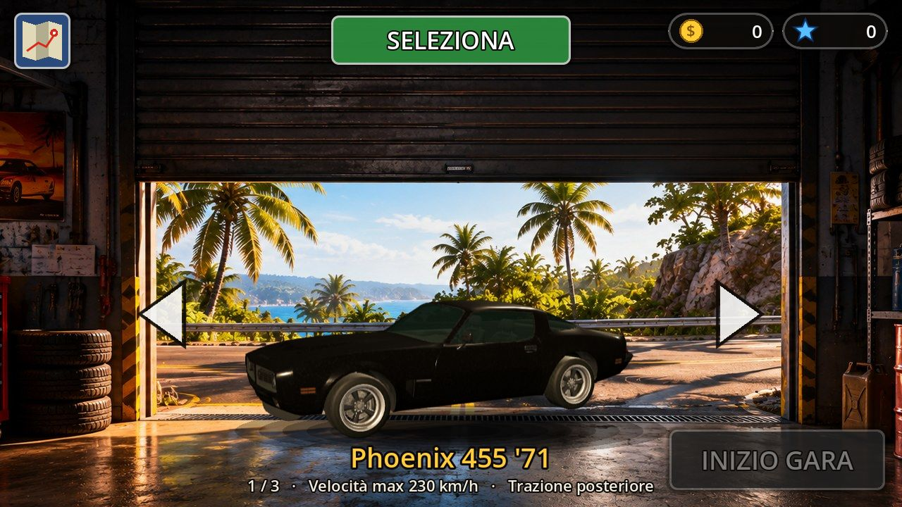

**Richiesta:** Stefano ha chiesto "diverse modifiche strutturali". Niente più menù iniziale: "il
giocatore si troverà ad entrare direttamente nel garage", con un'auto "bella in grande" al centro,
nome e caratteristiche sotto, due frecce ai lati per scegliere fra 3 modelli, un pulsante
"Seleziona" sopra ("una volta selezionata l'auto il giocatore non potrà più cambiare"), denaro e
reputazione in alto a destra, il pulsante della mappa in alto a sinistra e "Inizio gara" in basso a
destra, che porta alla prima gara sulla costa. In gara, "una piccola mappa interattiva" con una
freccia nera per il giocatore e tre rosse per gli avversari. E al posto della barra di caricamento,
un'immagine sua: il garage visto dal cofano, con la serranda che si apre man mano che il
caricamento avanza.

**Come è stato costruito:**
- **Garage** (`scripts/menu.gd`): lo sfondo è la sua immagine senza il cofano in primo piano;
  l'auto è un modello 3D che gira lentamente su un'ombra morbida, in una finestra larga quasi metà
  schermo. Le frecce (disegnate in codice) scorrono le 3 auto di partenza, per ora segnaposto
  (`CarCatalog.STARTER`). "Seleziona" chiede una conferma con un secondo tocco, poi l'auto è
  salvata sul telefono (`scripts/save_game.gd`, file `user://partita.cfg`), le frecce spariscono
  e si sblocca "Inizio gara". Denaro e reputazione si leggono dallo stesso file e per ora restano a
  0: nessuna gara li cambia ancora. La mappa mostra solo "arriverà presto".
- **Minimappa** (`scripts/minimap.gd`): in alto a sinistra, il percorso della gara visto dall'alto,
  con partenza verde e arrivo bianco; le frecce seguono posizione e direzione delle auto. Il
  percorso è disegnato una volta sola, ogni fotogramma si ridisegnano solo le 4 frecce.
- **Caricamento** (`scripts/hud.gd`): `tools/art/garage_images.py` ritaglia dall'immagine la
  serranda e la allunga ripetendo le sue lamelle, così da chiusa arriva fino a terra. Il
  caricamento la fa salire dal pavimento fino a dove è nell'immagine, con un breve scorrimento;
  il pavimento e il cofano si illuminano man mano che entra la luce. In alto il titolo, la
  percentuale e la fase.

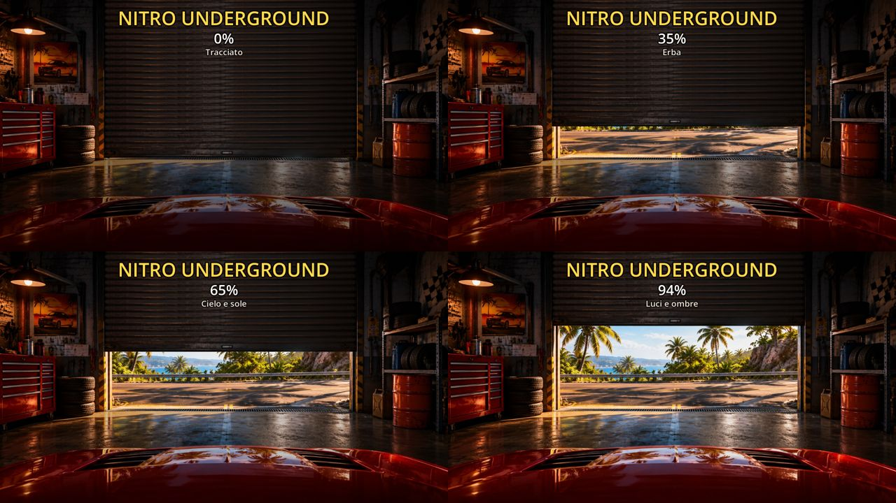

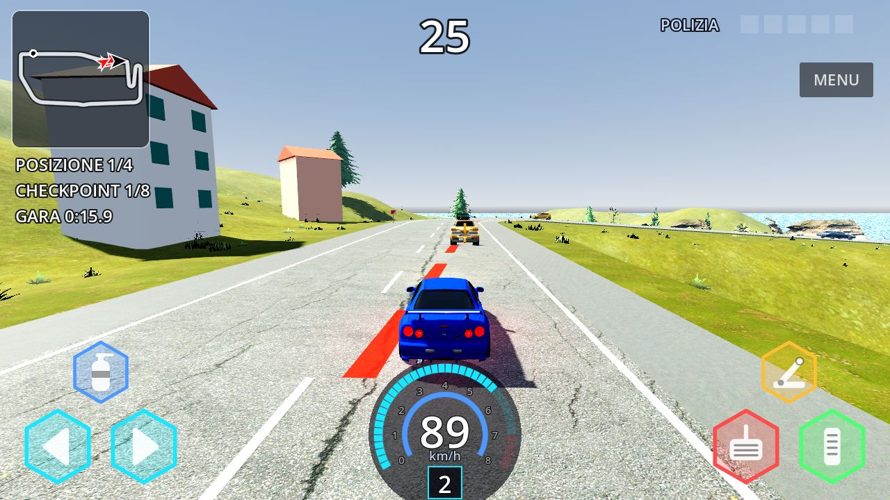

**Verifica ed esito:** screenshot del garage prima e dopo la scelta e una gara automatica sulla
costa con le immagini del caricamento e della minimappa (render senza GPU nel cloud). Da provare
sul telefono. Stefano l'ha provata sul PC: "lavora molto bene, soprattutto il caricamento della
partita. Ottima la mappa. E anche la selezione del veicolo." Le tre auto segnaposto restano.

---

## v0.18 — START, denaro e reputazione (7 novembre)

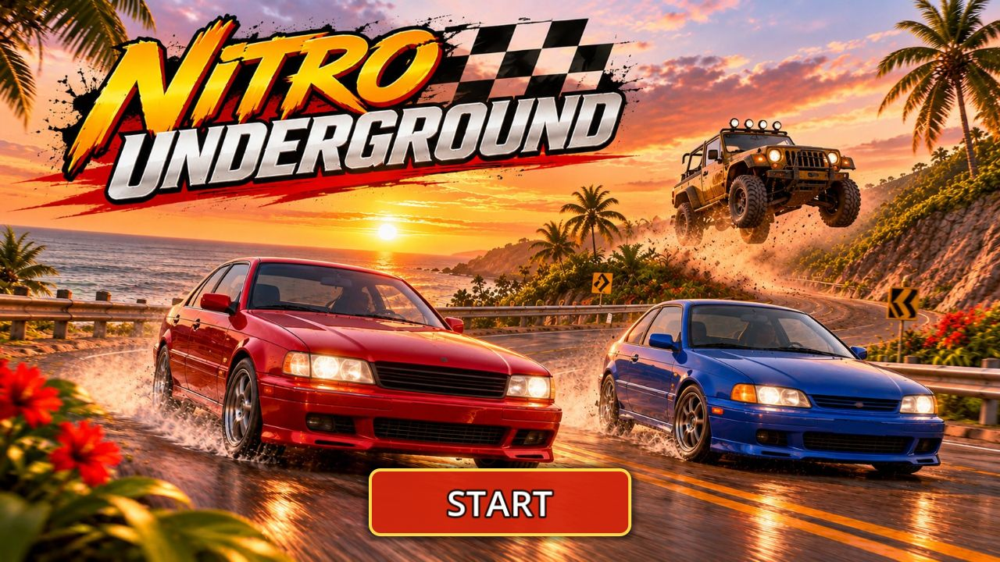

**Richiesta:** dopo la prova della v0.17 sul PC, Stefano ha fissato le regole: si parte con 2.000
di denaro e se ne guadagnano 5.000 a ogni gara; la reputazione parte da zero, +1.000 a ogni
vittoria, +20 a ogni derapata, "in combo raddoppia la vincita se la successiva derapata arriva
entro 3 s", +100 per ogni inseguimento della polizia vinto. Poi: asfalto 10 cm sopra il terreno
("avevi ragione tu", a filo spesso il terreno lo copriva), tratteggio della traiettoria trasparente
al 50%, e una pagina d'attesa con una sua immagine e solo un pulsante START in basso al centro.

**Come è stato costruito:**
- **Pagina d'attesa** (`scripts/title.gd`, `scenes/title.tscn`): è la prima scena del gioco;
  l'immagine copre lo schermo e START, che pulsa piano, apre il garage.
- **Denaro** (`scripts/main.gd`, `scripts/save_game.gd`): 5.000 a ogni gara portata al traguardo,
  qualunque sia il piazzamento; niente se scade il tempo o se arriva l'arresto. Le partite salvate
  dalla v0.17 con 0 passano a 2.000.
- **Reputazione:** la derapata conta quando finisce, se è durata almeno mezzo secondo; quella dopo,
  se comincia entro 3 secondi, vale il doppio (20, 40, 80... fino a 320). Ogni guadagno compare per
  un attimo sotto il pulsante MENU ("Derapata x4 +80 REP"); il totale della gara è nella schermata
  finale ed è salvato anche se si esce o si riparte a metà.
- **Asfalto e traiettoria** (`scripts/mountain.gd`, vale per tutti i circuiti): terreno 10 cm sotto
  la strada, trattini della traiettoria con trasparenza al 50%.

**Verifica ed esito:** screenshot della pagina d'attesa e del garage con 2.000 di partenza, gara
automatica sulla costa con i guadagni di reputazione scritti nel registro. Stefano l'ha provata e ha
deciso che raddoppiare ogni derapata era troppo: la combo è stata rifatta nella v0.19.

---

## v0.19 — Il dealer (8 novembre)

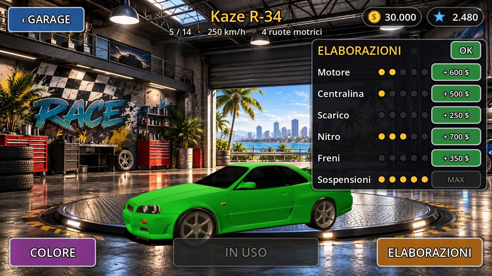

**Richiesta:** "la parte fondamentale è costruire il dealer, ovvero l'autoconcessionaria", con una
sua immagine come sfondo: le altre auto in vendita, la possibilità di cambiare colore "con un RGB
classico", e un menù di modifiche su sei punti (motore, centralina, scarico, nitro, freni,
sospensioni), cinque livelli ciascuno a pallini, con prezzi tali che portare tutto al massimo costi
circa il doppio dell'auto; le tre auto di partenza valgono 9.000. Nel garage il pulsante per il
dealer; finita la prima gara si torna al garage e la gara dopo è la città. E una nuova combo: ogni
derapata vale 20, alla quinta di fila il totale raddoppia, dalla sesta ognuna vale 30, alla decima
il totale triplica.

**Come è stato costruito:**
- **Dealer** (`scripts/dealer.gd`, `scenes/dealer.tscn`): le 14 auto del garage girano una alla volta
  sul piatto dello showroom, con le frecce, il prezzo e "COMPRA"; quelle già possedute mostrano
  "GUIDA QUESTA". Si caricano dal disco solo l'auto in vista e le due vicine.
- **Colore:** tre cursori R, G, B; l'auto cambia colore mentre si muovono. Il gioco tinge solo il
  materiale della carrozzeria (indicato per ogni auto in `scripts/car_catalog.gd`), così le
  carrozzerie con texture tengono i dettagli. "ORIGINALE" torna al colore del modello.
- **Elaborazioni** (`scripts/tuning.gd`): sei righe con cinque pallini e il prezzo del livello dopo.
  Ogni parte ha una quota un po' diversa del totale (fissa per ogni auto) e i livelli alti costano
  di più. In gara, ad esempio, il motore dà +4% di spinta per livello, i freni +6% di frenata.
- **Salvataggio** (`scripts/save_game.gd`): auto possedute, auto in uso, colori, livelli, prossima
  gara. Nel garage le frecce ora scorrono le auto possedute; quella in vista è quella che si guida.
- **Campagna:** Costa, Città, Deserto, Montagna, poi di nuovo dall'inizio; il pulsante del garage
  dice quale gara aspetta. Si passa alla successiva arrivando al traguardo.
- **Combo** (`scripts/main.gd`): dieci derapate di fila valgono 1.050 punti reputazione.

**Verifica ed esito:** la combo è stata provata a parte (20, 20, 20, 20, +120, 30, 30, 30, 30, +730);
ogni auto è stata dipinta di fucsia per controllare che il colore prenda la carrozzeria giusta (la
Goblin ha due gusci sovrapposti: la vernice viene spinta fuori di un soffio); gara automatica sulla
costa con l'auto verde e tre elaborazioni. Da provare su PC e telefono.

---

## v0.20 — Il dealer rifatto (8 novembre)

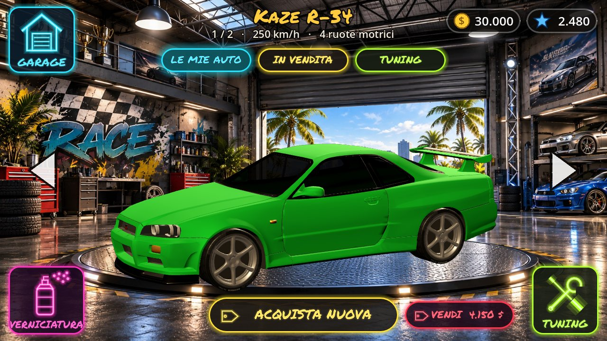

**Richiesta:** dopo la prova su PC della v0.19, Stefano ha trovato l'auto "decentrata rispetto
alla piattaforma" e "molto piccola": da raddoppiare. Poi un pulsante per dividere le auto del
garage, quelle da comprare e le elaborazioni; sull'auto in uso il pulsante deve diventare "acquista
nuova"; la vendita delle auto (mai l'ultima), pagata il 50% al massimo con un po' di valore in più
per ogni elaborazione; 15 colori al posto dell'RGB; elaborazioni come grandi icone che scorrono di
lato, con i pallini "stage 1-5" e il prezzo, ogni stage più caro del precedente. E i pulsanti,
"veramente orribili": icone con scritte moderne, un po' graffiti, colori al neon, una bomboletta per
la verniciatura, chiave inglese e cacciavite incrociati per il tuning, una casa con la serranda per
il garage.

**Come è stato costruito:**
- **Auto sul piatto** (`scripts/dealer.gd`): la finestra 3D ora copre tutto lo schermo e la camera
  viene calcolata dalla posizione del piatto nell'immagine di Stefano. Lo sfondo copre lo schermo
  tenendo le proporzioni, quindi il gioco rifà lo stesso conto (scala e ritaglio) e mette il centro
  dell'auto sul centro del piatto, lunga quasi quanto il piatto, su qualunque schermo (PC 16:9 o
  telefono 20:9). Camera leggermente dall'alto (7°) come la foto, obiettivo più "lungo" per non
  deformare l'auto.
- **Tre sezioni** in alto: LE MIE AUTO, IN VENDITA, TUNING. Le frecce scorrono solo le auto della
  sezione. Sull'auto in uso il pulsante centrale dice "ACQUISTA NUOVA" e porta alle auto in vendita;
  sulle altre auto possedute dice "GUIDA QUESTA"; tra quelle in vendita "COMPRA".
- **Vendita:** il pulsante VENDI compare solo con almeno due auto e chiede conferma al primo tocco.
  La richiesta era ambigua (50% più 0,2% per stage, ma "al massimo il 50%"); scelta: il 44% del
  prezzo più lo 0,2% per ogni stage montato, così un'auto con tutto a stage 5 (30 stage) arriva
  esattamente al 50%. Colore e tuning dell'auto venduta spariscono con lei.
- **Verniciatura:** 15 colori (dal bianco al nero, rossi, arancio, giallo, verdi, azzurri, blu,
  viola, rosa) e ORIGINALE.
- **Tuning a schede:** sei schede grandi, ognuna con la sua icona, il nome, cosa fa, i cinque
  pallini "stage 1-5" e il prezzo dello stage dopo; scorrono di lato. I prezzi ora salgono per
  forza a ogni stage (almeno 50 $ in più), anche dopo l'arrotondamento.
- **Stile neon** (`scripts/neon.gd`): icone disegnate nel codice come tubi al neon (casa con
  serranda, bomboletta, chiave e cacciavite, motore, centralina, scarico, bombola nitro, disco del
  freno, molla), pulsanti scuri con il bordo luminoso, scritte nel font Permanent Marker (stile
  pennarello, licenza Apache 2.0, `assets/fonts/`).

**Verifica ed esito:** screenshot del dealer in 16:9 e in 20:9 in tutte le sezioni; prova a parte di
vendita (l'ultima auto non si vende, vendendo quella in uso si passa all'altra) e dei prezzi degli
stage (nessuno stage costa meno o uguale al precedente, su tutte le 14 auto). Da provare su PC e
telefono.

---

## v0.20.1 — Pastello, catalogo e ombra (8 novembre)

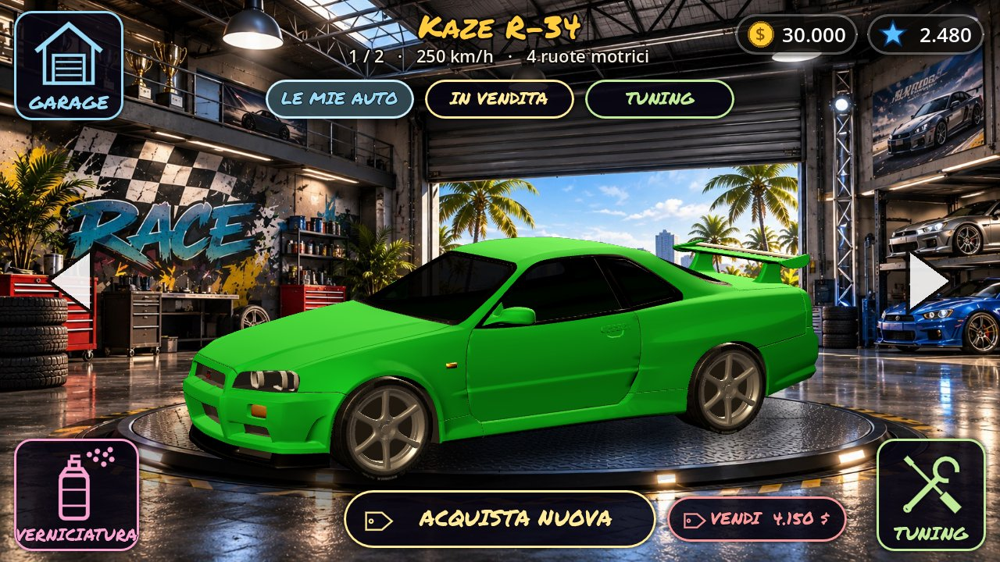

**Richiesta:** dopo la prova su PC della v0.20, Stefano ha trovato il neon troppo forte: "teniamo un
colore pastello". Per il tuning ha chiesto una sola scheda in basso a destra, con due frecce per
sfogliare i pezzi "come se stessimo sfogliando un catalogo". E ha notato che l'auto sembrava
"appiccicata" sulla foto: niente ombre, quasi rialzata dietro.

**Come è stato costruito:**
- **Pastello** (`scripts/neon.gd`): stessi disegni e stesso font, ma colori tenui, nessun alone;
  icone e scritte hanno un bordo scuro per leggersi su qualunque sfondo.
- **Catalogo del tuning** (`scripts/dealer.gd`): una scheda (icona, nome, cosa fa, pallini stage
  1-5, prezzo, "1 / 6") con le frecce ai lati; l'auto resta sul piatto, più piccola e spostata a
  sinistra.
- **Auto appoggiata:** il modello viene abbassato finché le gomme toccano il piatto (prima ogni
  auto stava all'altezza del suo punto d'origine). Sotto l'auto c'è un'ombra morbida che gira con
  lei. La finestra 3D ha lo sfondo trasparente e lì Godot non riesce a sfumare un'ombra
  semitrasparente (provato: non si vedeva), quindi l'ombra è disegnata in 2D sotto la finestra,
  proiettando la sagoma dell'auto con la stessa camera 3D.

**Verifica ed esito:** screenshot di tutte le sezioni. È un rimedio: per un'integrazione vera con
riflessi e luci coerenti serve uno showroom costruito in 3D. Da provare su PC.

---

## Prossimi passi

- Prova sul telefono e sul PC della v0.20.1; decidere se costruire lo showroom del dealer in 3D.
- Gli altri pulsanti (garage, menù) nello stesso stile neon; gare che pagano in modo diverso, cosa mostra la mappa.
- Togliere i loghi dipinti nelle texture delle auto di marchi reali; aggiungere i mezzi della seconda ricerca (fuoristrada, pick-up, buggy, traffico di città).
- Costruire il nuovo aspetto realistico (luce, cielo, ombre, materiali) un passo approvato alla volta.
- Passo 3 del piano: **vertical slice**, cioè un circuito e un'auto rifiniti al livello del gioco finale.
- Prima di qualsiasi pubblicazione: sostituire i modelli non commerciali e di marchi reali
  (vedi [CREDITI.md](../CREDITI.md)) e aggiungere i titoli di coda con i crediti CC BY.
