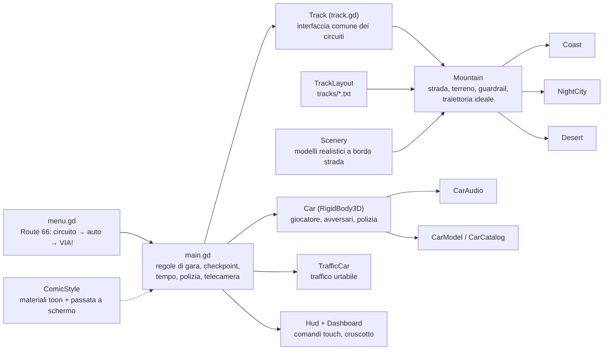
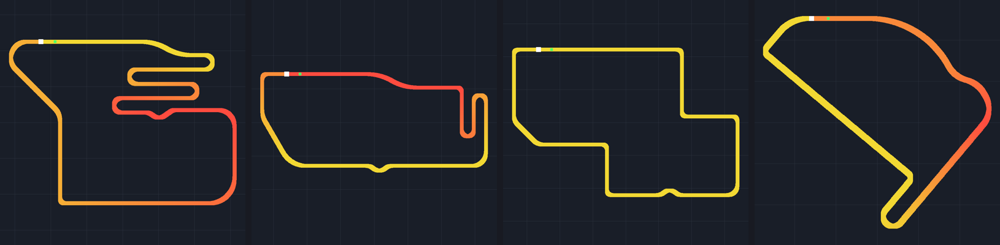
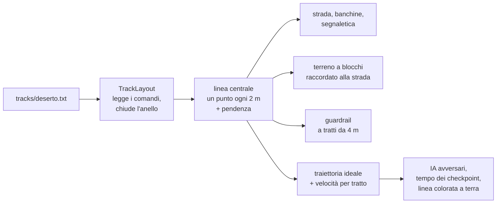

# Come è costruito Nitro Underground

Questo documento spiega **come funziona il gioco dentro**: le scelte tecniche, perché sono state
fatte e come sono state verificate. È pensato per chi valuta il progetto (recruiter, sviluppatori,
game designer) e vuole capire cosa c'è dietro gli screenshot.

> Contesto: il gioco è stato ideato e diretto da Stefano Paglierani, che ha preso ogni decisione di
> prodotto e ha provato ogni build su telefono e PC. Il codice è stato scritto da Claude
> (assistente AI di Anthropic) sulle sue indicazioni. Vedi la [storia dello sviluppo](STORIA.md).

## Indice

1. [Numeri del progetto](#1-numeri-del-progetto)
2. [Architettura](#2-architettura)
3. [Fisica dell'auto](#3-fisica-dellauto)
4. [Avversari, traffico e polizia](#4-avversari-traffico-e-polizia)
5. [Circuiti scritti come mappe di testo](#5-circuiti-scritti-come-mappe-di-testo)
6. [Grafica: lo stile a fumetto 2.5D](#6-grafica-lo-stile-a-fumetto-25d)
7. [Audio](#7-audio)
8. [Asset: fonti, licenze e ottimizzazione](#8-asset-fonti-licenze-e-ottimizzazione)
9. [Prestazioni su telefono](#9-prestazioni-su-telefono)
10. [Prove automatiche e strumenti](#10-prove-automatiche-e-strumenti)
11. [Build e distribuzione delle versioni di prova](#11-build-e-distribuzione-delle-versioni-di-prova)

---

## 1. Numeri del progetto

| | |
|---|---|
| Durata | 5 giorni, dal 27 al 31 ottobre 2026 (concept → v0.11.1) |
| Versioni provate su telefono o PC | 12 (v0.1 → v0.11.1), più varianti di prova |
| Codice | ~7.500 righe di GDScript nel gioco, ~500 di shader, ~1.000 di strumenti e test |
| Circuiti | 4 (Montagna, Costa, Città di notte, Deserto), da 1,7 a 2,8 km |
| Auto nel garage | 7, ognuna con velocità massima e trazione proprie |
| Asset di terze parti | oltre 120 voci nel registro licenze (modelli, texture, suoni), CC0 e CC BY più le eccezioni dichiarate |
| Budget | 0 €: solo strumenti e asset gratuiti |

## 2. Architettura

Il gioco è fatto con **Godot 4.7** in **GDScript**, renderer **Mobile (Vulkan)**, fisica **Jolt**.
Una scelta presa al primo giorno: quasi tutto viene **costruito dal codice**. Le scene `.tscn`
sono due file quasi vuoti (menu e gara); strade, terreno, guardrail, alberi, auto, interfaccia e
materiali nascono dagli script. Così ogni cosa è testo leggibile, versionabile e modificabile senza
aprire l'editor, che era fondamentale per un progetto sviluppato in sessioni remote.



- **`Track`** è l'interfaccia che il resto del gioco conosce: punti della strada, punto più
  vicino, corsie del traffico, velocità consigliata in curva, altezza del terreno. `Mountain`
  la implementa, e `Coast`, `NightCity` e `Desert` estendono `Mountain` ridefinendo solo dei
  "ganci" (terreno, materiali, dove crescono gli alberi, cosa c'è a bordo strada). Aggiungere
  un circuito vuol dire scrivere una mappa e, se serve, una sottoclasse di poche centinaia di righe.
- **`Car`** è la stessa classe per giocatore, avversari e polizia: un controllore riempie gli
  ingressi (`in_throttle`, `in_steer`...) e la fisica fa il resto. Le auto del computer guidano
  quindi con le stesse regole del giocatore, senza scorciatoie.
- **`CarCatalog`** descrive ogni auto (modello, velocità massima, trazione, nome) e il garage.

## 3. Fisica dell'auto

`scripts/car.gd` · banco prova `tests/physics_bench.gd`

L'auto è un **`RigidBody3D`** portato da quattro ruote simulate a mano, non un `VehicleBody3D`
già pronto, per avere il controllo completo del comportamento:

- **Ruote come cilindri proiettati verso il basso** (shape cast), non semplici raggi: una ruota
  che incontra un cordolo ci sale sopra invece di sbatterci contro.
- **Sospensioni molla-smorzatore** per ruota, con estensione smorzata 1,8 volte più della
  compressione (come un ammortizzatore vero), così un atterraggio pesante non rilancia l'auto in aria.
- **Gomme con aderenza limitata dal carico** su quella ruota, spinta lungo e di traverso alla strada:
  in frenata il peso va avanti e il retro si alleggerisce, come nella realtà.
- **Trazione dalle ruote motrici**: anteriore, posteriore o integrale a seconda dell'auto
  (`front_drive` da 0 a 1). Le ruote anteriori sterzano davvero e l'auto va dove puntano.
- **Cambio automatico a 6 marce** con rapporti lunghi e forza che cala con la marcia
  (`forza ~ rapporto^0,55`), giri motore da 900 a 7.800 per cruscotto e audio.
- **Sterzo che si stringe con la velocità** (da 38° a passo d'uomo a 9° oltre 160 km/h), e il
  giocatore sterza il 30% più dolcemente degli avversari (richiesta di Stefano dopo le prove).
- **Freno a mano** che toglie aderenza al posteriore per la derapata, e un piccolo aiuto
  d'imbardata che rende la guida arcade senza togliere la fisica.
- **Salti**: in aria lo sterzo non fa nulla (un'auto non ha contro cosa girare); l'auto si
  raddrizza da sola. Vengono contati decollo, rotazioni e qualità dell'atterraggio.

**Verifica con numeri, non a sensazione.** Il banco prova guida un'auto di riferimento su un
terreno di test, misura e stampa tutto in JSON. Va lanciato a 30, 60 e 120 tick al secondo per
controllare che la fisica non cambi col frame rate. Risultati a 60 tick (v0.11.1):

| Prova | Risultato |
|---|---|
| 0-100 km/h | 3,48 s |
| Frenata da 144 km/h | 62,9 m in 3,2 s |
| Velocità massima (auto di riferimento) | 225,9 km/h |
| Curva stretta a 59 km/h / curva veloce a 101 km/h | 1,85 g / 2,08 g laterali |
| Salto da rampa a 15° a 90 km/h | 19,7 m, **−2,5%** dalla traiettoria balistica teorica |
| Salto da rampa a 25° a 107 km/h | 45,9 m, **−2,0%** dalla traiettoria balistica teorica |
| Inclinazione all'atterraggio | 2,4-2,6° (atterraggio pulito, auto dritta dopo 4 s) |
| Cordolo da 15 cm a 40 e 90 km/h | superato in entrambi i casi |
| Caduta da 8 m | rimbalzo 0,1 m, ferma in 0,2 s, resta dritta |
| Urto frontale contro un muro a 156 km/h | ferma in mezzo secondo |

La stessa prova a frame rate diversi dà risultati quasi identici, quindi la guida non cambia tra
un telefono lento e uno veloce:

| Tick al secondo | 0-100 km/h | Frenata da 144 km/h | Velocità massima | Salto a 25° |
|---|---|---|---|---|
| 30 | 3,53 s | 62,9 m | 226,0 km/h | 45,4 m |
| 60 | 3,48 s | 62,9 m | 225,9 km/h | 45,9 m |
| 120 | 3,47 s | 62,9 m | 226,2 km/h | 45,5 m |

## 4. Avversari, traffico e polizia

- **Avversari** (`car.gd`, `mountain.gd`): seguono la **traiettoria ideale** del circuito e
  frenano prima delle curve leggendo la velocità consigliata. Quando c'è traffico davanti
  calcolano uno spostamento laterale per sorpassarlo dal lato libero, poi tornano sulla linea.
  Dopo un urto perdono aderenza per un attimo (`_knocked`), così uno scontro li scompone davvero.
  Prendono le curve al 92% della velocità consigliata e, se non raggiungono il punto successivo
  del percorso per 8 secondi, vengono rimessi su quel punto.
- **Traffico** (`traffic.gd`): 24 auto civili che sono **corpi rigidi con il peso di un'auto**.
  Mentre guidano, una spinta limitata le tiene in corsia alla loro velocità: un colpo più forte di
  quella spinta le sposta, uno molto forte le fa girare e sbandare sotto gravità. Qualsiasi urto da
  un'auto in gara le ferma per 3 secondi; poi ripartono da sole, aggirando di lato l'auto che le
  blocca, e tornano in corsia. Se sono ribaltate, fuori dalla vista dei piloti tornano in corsia. Livelli di collisione separati evitano che il traffico
  si comporti come una massa infinita (in Jolt le collisioni sono "a senso unico").
- **Polizia** (`main.gd`): chiamata dopo 20 secondi di gara; gli incidenti alzano un livello di
  allerta e più è alto, più volanti compaiono. Ogni volante insegue la prima auto in gara che
  incontra e passa al giocatore quando lui le passa entro 35 m. Arresto se il giocatore resta sotto
  i 5 km/h accanto a una volante per 5 secondi; seminata se resta oltre 110 m per 10 secondi.
- **Pausa** (`main.gd`, `hud.gd`): pulsante MENU, tasto Indietro di Android e gioco in secondo
  piano fermano l'albero della scena (`get_tree().paused`); solo l'interfaccia resta attiva.
- **Tempo a scalare**: per ogni tratto tra due checkpoint il gioco calcola il tempo ideale sulla
  traiettoria ideale e concede `tempo ideale × 1,55 + 4 s`. Un tratto pieno di tornanti dà più
  tempo di un rettilineo, e il tempo avanzato si somma al tratto dopo.
- **Mondo chiuso**: un'auto che resta oltre il guardrail per 3 secondi, o cade dalla montagna,
  viene rimessa in strada.

## 5. Circuiti scritti come mappe di testo

`scripts/track_layout.gd` · mappe in `tracks/*.txt` · guida per non programmatori in [`tracks/COME_FARE.md`](../tracks/COME_FARE.md)

Stefano voleva circuiti più vari **e poterli disegnare lui senza programmare**. La soluzione è un
piccolo linguaggio in italiano che si legge come un navigatore, un pezzo di strada per riga:

```text
# ROUTE 66 - mappa del circuito "Deserto"
PARTENZA
DRITTO 520            # il lunghissimo rettilineo della Route 66
DESTRA 60 220         # curvone velocissimo
SALITA 4
ESSE SINISTRA 45 70   # dentro il canyon
TORNANTE DESTRA 24    # tornante in fondo al canyon
GOMITO SINISTRA       # entrata in paese
...
```



*Montagna (2,8 km), Costa (2,0 km), Città di notte (2,2 km), Deserto (1,7 km), disegnati dalle loro
mappe di testo. Il colore indica l'altitudine, dal giallo (punto più basso) al rosso (più alto); il quadrato bianco è la partenza.*

Dalla mappa al circuito giocabile:



- **Chiusura automatica dell'anello**: le curve vengono ritoccate perché sommino a un giro
  completo e i rettilinei allungati o accorciati di poco perché la fine incontri la partenza.
  Chi scrive la mappa non deve fare conti.
- **Traiettoria ideale**: una fascia "tirata" dentro la carreggiata con 220 passaggi di
  rilassamento (prima larghi per dare forma alla curva, poi fini per lisciarla), così allarga prima
  della curva, tocca l'interno e riallarga. La velocità lungo la linea viene dal raggio di curvatura
  (`v = √(μ·g·r)`), poi da un passaggio all'indietro con la frenata e uno in avanti con
  l'accelerazione, ripetuti due volte perché il giro si chiuda. Sull'asfalto diventa una linea
  tratteggiata verde (accelera), gialla (molla) o rossa (frena).
- **Controllo della mappa**: `tools/map_preview.gd` disegna la mappa in PNG e misura la distanza
  minima tra tratti di strada diversi (sotto ~33 m si sovrapporrebbero), così un errore si vede
  prima di avviare il gioco.

## 6. Grafica: lo stile a fumetto 2.5D

`scripts/comic_style.gd` · `shaders/stylize.gdshader` e altri 12 shader

Dopo aver provato uno stile realistico, uno anime e uno a fumetto, Stefano ha scelto il **fumetto
2.5D** (in stile film d'animazione recenti) come unico stile. Il gioco resta 3D, ma viene
"disegnato":

- **Materiali toon**: ogni materiale che entra in scena, anche aggiunto dopo (auto, detriti,
  l'auto del garage), viene convertito in luce a bande con ombre nette.
- **Contorno a inchiostro** sulle auto.
- **Passata a schermo intero** (`stylize.gdshader`): colori appiattiti in bande, linee
  d'inchiostro dove la profondità salta, retino a puntini nelle ombre, tratteggio nelle zone più
  scure, e lastre di colore rosse e blu leggermente sfasate che crescono con la distanza al posto
  della sfocatura (effetto "stampa fuori registro").
- **Cielo pop-art** dipinto da shader, **linee di velocità** ad alta velocità e col nitro.
- **Ambientazioni realistiche disegnate**: alberi, palazzi, palme, motel sono modelli 3D
  realistici (CC BY) che passano dentro lo stile, così il risultato è ricco ma coerente.
- **Città di notte luminosa**: finestre accese da uno shader di facciata, pozze di luce sull'asfalto,
  neon e 8 luci vere che seguono la telecamera (la prima città notturna era stata scartata perché troppo buia).
- **Menu Route 66**: illustrazione originale disegnata in SVG (`tools/art/route66.svg`) e
  trasformata in immagine con Chromium.

## 7. Audio

`scripts/car_audio.gd` · `tools/audio/make_engine_sounds.py`

- **Motore V8 sintetizzato da zero** in Python: 6 registrazioni ad anello a 1.000, 2.000, 3.200,
  4.500, 6.000 e 7.600 giri, ognuna a gas aperto e a gas chiuso. Nessun campione esterno, quindi
  nessun problema di licenza.
- **Miscelazione in tempo reale**: a ogni fotogramma i due anelli più vicini ai giri attuali
  vengono dissolti l'uno nell'altro e intonati ai giri esatti, e le versioni gas aperto/chiuso
  vengono miscelate secondo l'acceleratore. Verificato registrando un video della partita: la
  frequenza degli scoppi segue i giri.
- **Eventi**: cambiata con soffio del turbo, scoppiettii in rilascio, gomme che stridono in frenata
  e in derapata, nitro, vento, urti di tre intensità, tonfo dell'atterraggio, sirena. Le
  registrazioni sono CC0 (Freesound, OpenGameArt), tagliate e normalizzate con uno script.
- Le altre auto sono suoni 3D posizionati e si spengono oltre una certa distanza, per risparmiare
  calcolo sul telefono. Un limitatore sul bus principale evita la distorsione.

## 8. Asset: fonti, licenze e ottimizzazione

- **Budget zero e licenze tracciate**: ogni file in `assets/` è registrato in
  [`assets/LICENSES.md`](../assets/LICENSES.md) con fonte, autore, link, licenza alla data del
  download e modifiche. Le eccezioni non commerciali sono dichiarate in [`CREDITI.md`](../CREDITI.md).
- **Fonti**: Poly Haven (cieli, texture PBR), Kenney, KayKit, OpenGameArt, Freesound (CC0) e
  Sketchfab (CC BY), quest'ultimo scaricato via API.
- **`Scenery`**: ogni modello viene scalato all'altezza reale, appoggiato a terra e **fuso in una
  sola mesh con una superficie per materiale**. Un modello fatto di 123 pezzi passava da oltre
  1.000 chiamate di disegno a una manciata.
- **Texture** dei nuovi paesaggi compresse per la GPU (VRAM) e limitate a 512-1024 px.
- **Libreria separata**: i modelli scaricati ma non usati restano fuori dall'APK grazie ai filtri
  di esportazione (`export_presets.cfg`), e la libreria completa vive fuori dal repository.

## 9. Prestazioni su telefono

Il bersaglio è un telefono Android di fascia media, e alcune scelte vengono da problemi veri
segnalati da Stefano:

- **Blocco al 69% del caricamento (v0.10)**: risolto costruendo solo il circuito scelto invece di
  tutto, caricando i modelli delle auto **in thread paralleli** mentre si costruisce il livello,
  spegnendo il 3D durante la costruzione e correggendo due cause trovate nel codice: un cielo che
  ricalcolava la mappa dei riflessi a ogni fotogramma e un panorama 2K inutilizzato che finiva nell'APK.
- **Barra di caricamento sempre visibile**, perché il giocatore deve capire se il gioco lavora o è bloccato.
- **Memoria**: tornando al menu i modelli delle auto della gara vengono liberati; il menu tiene
  solo l'auto in mostra.
- **Terreno a blocchi** (32×32 celle) e alberi disegnati con MultiMesh; guardrail raggruppati in
  pochi corpi fisici, così la rottura di un tratto ricostruisce solo un pezzo piccolo.
- **Misure**: lo strumento di screenshot stampa triangoli e chiamate di disegno per inquadratura,
  per controllare il costo di ogni ambientazione prima della prova sul telefono.

## 10. Prove automatiche e strumenti

| Strumento | A cosa serve |
|---|---|
| `tests/physics_bench.gd` | Banco prova della fisica (tabella sopra), risultati in JSON |
| `--autotest` | L'auto del giocatore corre da sola l'intera gara con seme fisso e stampa un registro; con `--shots=` salva screenshot |
| `tools/map_preview.gd` | Disegna le mappe e controlla le distanze minime |
| `tools/shot.gd` | Screenshot di un circuito da punti scelti, con statistiche di rendering |
| `tools/pack_sheet.gd`, `inspect_glb.gd` | Mostrano i pezzi dentro un pacchetto di modelli |
| `tools/air_test.gd` | Prove del comportamento in volo |

Ogni versione è stata controllata con questi strumenti prima di essere consegnata, e poi provata
da Stefano sul telefono: le sue impressioni sono la base della versione successiva.

## 11. Build e distribuzione delle versioni di prova

- **APK Android** costruiti in un container cloud senza Android SDK ufficiale: Godot esporta
  l'APK con i template ufficiali e la firma viene fatta da un piccolo firmatario Java basato su
  `apksig`. Solo arm64, per tenere l'APK sotto i ~310 MB nonostante i modelli dettagliati.
- **Prova su PC senza installare niente**: `tools/windows/Gioca-Nitro.bat` scarica Godot e
  l'ultima build dal ramo `prova-pc`, la importa e la avvia; riscarica solo quando il ramo cambia.
  È nato perché spostare ogni volta un APK di 300 MB sul telefono era la parte più scomoda delle prove.
- **Pull request per ogni versione**, con descrizione in italiano di cosa cambia e come è stato verificato.
